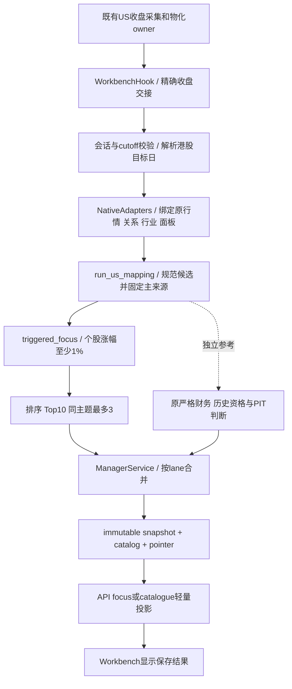

# 美股映射选股：真实状态、唯一工作流与清理结果

基线：`01e2828e7a04dde6b6448eaa80a1fdd67ba641a0`；工作分支：`codex/us-mapping-workflow-cleanup-20261025`。本报告更新于2026-10-25。

## 美股23日收盘后的真实结果

自动任务确实执行了，尚未生成新版重点推荐。它在北京时间 **10月24日04:17** 保存了港股目标日 **20261026 / NEXT_DAY** 的草案：`d725567793324cfea5617018e989a4da`，trigger 为 `SCHEDULED`，US 与 HK price source session 都是 `20261023`。

| 证据层 | 已确认结果 |
|---|---|
| 原不可变 snapshot | 701条股票记录，原总体计数 selected=0 / unassessed=701；没有顶层 selection/focus 合同 |
| 当前API读取同一run | stocks为空、total=0、legacy=true、selection_identity=null；旧lane投影口径为699待评估+2未入选，与原总体计数分开保留 |
| 旧单日摘要 | `US_HK_SINGLE_DAY_MAPPING_V1_20261019`，`strict_v1_status=PAUSED_NOT_EXECUTED`；这是旧代码状态，并不是维护暂停指令 |
| 此前23日页面10只 | run444db…使用US22/HK价格22，是手动事后回看，不能替代本次US23自动结果 |
| 新版真实入口离线演练 | 原US23输入可以生成10个focus；87有效触发、77受限额排除、504未触发、79待核。严格参考仍0入选，不宣称正式资格或预测效果 |

[读取真实26日自动草案](http://127.0.0.1:8873/manager-selection/?date=20261026&phase=NEXT_DAY&run_id=d725567793324cfea5617018e989a4da)。此链接仍指向未改写的自动原件，不能把离线演练说成已自动发布。

### 时钟与来源

- US报价可用时间：`2026-10-23T20:15:06Z`。
- 冻结输入处理cutoff：`2026-10-24T04:17:00.772714+08:00`。
- 原保存snapshot的context cutoff：`2026-10-24T04:17:08.853475+08:00`。
- 原生成时间：`2026-10-24T04:17:09.202389+08:00`。
- 原input文件SHA：`e2c9ecd0dcedd303f6fabd6f199c9bf805dbc51c36f620c18dd9930386a5b16b`；US batch SHA：`f0ab42471b6bfdf10e1ff84e3566f565cb87b58463708aa87253a13765ba15df`。
- 这些时钟和原件均保留。离线演练不用当前时间冒充原截止时间，未读取收益标签。

## 唯一有效工作流

| 节点 | 唯一职责与源码位置 | 失败/恢复边界 |
|---|---|---|
| 采集 | `contracts/runtime_workloads.json` 的 `us_market_digest` → `ops/run_us_market_slot.py` / `ops/us_market_digest.py` | 复用既有owner；工作台不另抓同源，不增加producer |
| 调度 | `supervisor.py:WorkbenchHook` → `scheduler.py:tick/_us_close_handoff` | 收盘交接在HK交易日过滤之前检查，周六可接US周五；缺owner、错session/phase/cutoff不提交 |
| 绑定 | `inputs/source_bindings.py:us_mapping` | 对齐manifest、artifact、receipt、session和cutoff；目录日与US会话日分开 |
| 输入 | `inputs/native.py:us_mapping` / `inputs/strict_us_selection.py` | 同一数据owner；历史窗口/金额/复权证据缺失明确待核，不补零、不猜单位 |
| 候选 | `engines/core.py:run_lanes` → `engines/us_mapping.py:run_us_mapping` → `us_mapping_consumption.py:normalize_mapping_candidates` | 按HK归并，保留全部来源及正负冲突；先固定主路径再读收益 |
| 重点 | `engines/strict_us_selection.py:build_selection/triggered_focus` | 有效主US个股收益≥1%，同行业peer可用；ETF-only仅背景，未知为PENDING；收益/已证成交额/代码稳定排序，Top10/theme3 |
| 严格参考 | 同一selector的严格decisions | 与重点名单分层；不以缺少财务/PIT材料伪装正式通过，也不拿严格0覆盖全部研究focus |
| 保存 | `service.py:_work/_merge_phase_lane_snapshots` / `store.py` | 指纹纳入selection engine identity；旧零checkpoint不能跨引擎复用。各lane分别保留来源/输入SHA/cutoff，较旧US结果不能覆盖较新结果 |
| API | `api.py:recommendations` / `display.py:selection_view` | 读取保存判断，不临时重算。focus与完整catalogue分开；无selection的旧保存版走legacy读取 |
| 页面 | `apps/web/src/manager-workbench/api.ts/useWorkbench.ts/Workbench.vue` | 默认focus；只做展示、身份校验和分页，避免晚响应污染日期/版本 |

## 根因与版本边界

当次自动产物保存的是旧单日映射格式。当前网页服务位于 `a-share-stage-history-restore-20261025-r4`，已有新focus读写合同；当前配置的scheduler包位于 `local-panel-history-source-20261025-r2`，仍使用旧 `single_day_mapping_payload`、旧 `run_single_day_mapping/cannot_confirm_single_day_mapping`，缺少新selection和selection-aware checkpoint链路。新版源码已使用 `build_selection` 并保存顶层selection。

因此修复要对齐**自动执行包的完整US模块合同**，单改网页不会生成新自动名单。当前25日配置不能倒推24日04:17当次精确进程；当次PID、release/source SHA缺少完整证据，保持CANNOT_CONFIRM。

当前共享调度器由“核查本地研究面板修复进度”维护会话明确暂停，`launchctl`未加载；其日更前提存在 `LATEST_FACTOR_CACHE_CODE_MISSING:601091.SH`。这个A股缓存不是US选股的业务输入，但共享daemon的维护暂停构成操作约束。本批不修该缓存、不恢复旧包、不绕过暂停或生命周期守卫。

## 代码清理与必须保留的代码

本批仅改两份源码，删除10行；其余AST完全一致：

| 处理 | 符号 | 理由 |
|---|---|---|
| 已从本批新源码删除 | `us_mapping_consumption._is_noncurrent` | 当前完整源码、入口、测试、配置和导出无consumer；真实调用使用_current_scope_class |
| 已从本批新源码删除 | `strict_us_selection.cannot_confirm_single_day_mapping` | 当前完整新链不调用这个空占位返回helper |
| 保留 | `run_single_day_mapping`、strict核心、legacy_mapping_projection | 旧执行包/历史形态仍有消费者；不因旧或严格结果为0而删除 |
| 保留 | strict_selection_payload与single_day_mapping_payload兼容键 | 既有CLI/wiring读取旧键，当前是同一payload的兼容接口，不是两个producer |
| 保留/待合同退役 | 公开catalog helper、前端历史catalog字段、独立mapping-catalog API | 有导出、测试或历史读取消费者；当前生产者未写某字段不等于可盲删consumer |

**严禁把这两个清理后的文件单独覆盖旧r2执行包。** r2仍导入自己的cannot_confirm入口，单文件替换会ImportError。旧发布目录和其历史代码未动；后续必须把新版driver、输入、contracts、service/store及依赖闭包整体合入，取得独立运行验收后才部署。

## 已完成的验证

- 同一个真实run_us_mapping入口在相同US23冻结输入上，清理前后各运行一次；没有第三次强行重跑，没有模型、补采、网络或收益标签。
- 全部canonical selection除顶层engine_identity外完全一致，语义SHA为 `4beae13225634cfd5d0046f3ddcd7a25f33c7b52eb226679e06e648cfeb1a823`；policy/cutoff/全部理由与排名不变。
- 701条原记录逐项对账：449严格拒绝、221严格待核、31未形成映射候选。31条有master身份和classification原始行，但industry为空且无target/proxy路径；不是证券身份缺失，也没有删除原始记录。
- focus为10、strict仍为0。源变化使engine identity及缓存指纹正常更新，旧case没有被复用。
- 独立Reviewer复跑13个测试节点（15个参数化case），最终15 passed；AST及diff检查通过。隔离输出路径、pytest import/tmp初始化及辅助digest口径错误均有记录，未修改测试掩盖错误。
- 基线预检短暂生成2个源码pyc，已清理并披露；最终没有源外残留。未重跑87份历史、前端构建、完整constructor或自然周期。

### US23输入的离线focus（未发布、非自动产物）

| 名次 | HK代码 | 固定US主来源 |
|---:|---|---|
| 1 | HK.09688 | ZLAB |
| 2 | HK.01989 | TTMI |
| 3 | HK.02476 | TTMI |
| 4 | HK.03228 | TTMI |
| 5 | HK.02525 | HSAI |
| 6 | HK.02665 | HSAI |
| 7 | HK.06069 | FCNCA |
| 8 | HK.02883 | SLB |
| 9 | HK.00323 | CLF |
| 10 | HK.00347 | CLF |

这些代码只用于说明真实入口可产生研究focus；严格财务、PIT、资格、预测效果与交易许可均未因此通过。

## 自动链路的具体修复顺序

1. 与当前维护owner确认最终认可父包、数据及metadata身份、暂停释放和恢复边界。不能沿用已经失效的旧r6/QFQ差异草案、旧PID或旧恢复GO。
2. 以该最终父包继承其A股/QFQ修改，有限合入US模块闭包：新native/strict输入及历史resolver、candidate/focus/policy、LaneResult.selection、selection-aware service/checkpoint、store及精确收盘scheduler。不是将旧34项覆盖清单原样重放，也不是把API包冒充scheduler包。
3. 在隔离目录演练真实收盘交接→提交→同一引擎→按lane保存→API读取；用原US23 case验收，并保留旧run与各lane结果。补跑生成新run、保留原source/cutoff与新processing clock，明确恢复身份，不把补跑改名为自然运行。
4. 独立核不可变候选、实际角色解释器、完整构造/行为及lane合并。当前job absent，不能用旧“健康owner过渡”凭据直接activate；由原owner认可的恢复流程先恢复，或另行冻结有界absent启动验收，禁止伪造PID/放宽guard。
5. 正式启用后读回同一run的snapshot、API与页面，再验收两个完整自然US-close→HK NEXT_DAY/PREOPEN周期。按既有scheduler和原有低频跟进，不加producer或高频轮询。自然仍0/2，PIT与效果仍未验证。

本批完成的是源码清理、真实输入工程验证和可执行边界梳理。自动执行包尚未合入启用，live26日原草案仍0重点。研究用途、BUY门禁及订单状态保持不变。
