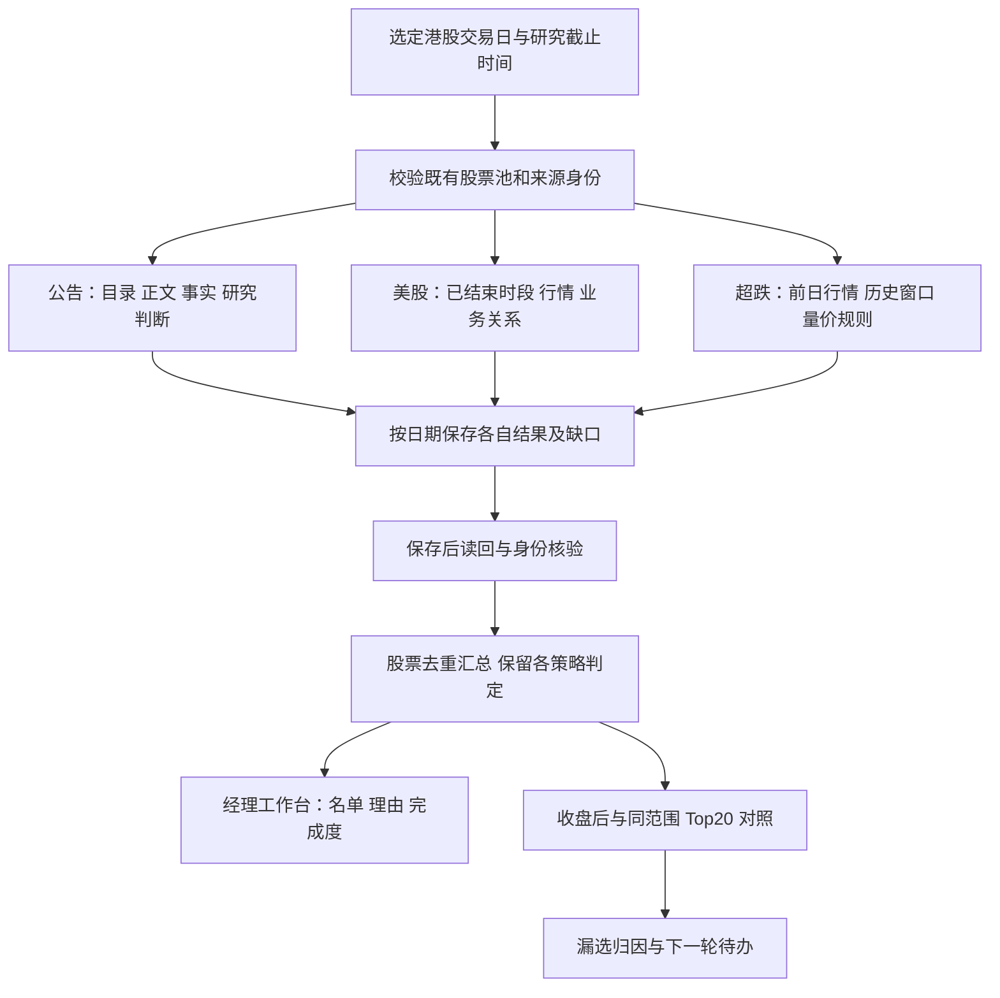

# 经理工作台运行与优化方案 · 2026-10-07

状态：方案完成，独立方案审阅 PASS。本文不是代码交付、部署回执或选股收益证明。

## 1. 目标与边界

经理工作台应对一个港股目标交易日回答四件事：哪些股票值得研究、分别因为什么、还有哪些条件或数据未确认、当日收盘后这些研究名单覆盖了什么。

三条研究线是公告、美股映射、超跌反弹。它们分别判断，合并为一张按股票去重的研究名单；原 Stage、港股通资格和 BUY 门禁仍走既有独立链路。一个来源失败只限制该来源的研究结论；不能把其他有效研究结果隐藏，也不能据此放宽正式选股门禁。

本轮交付是运行机制与实施方案，不修改业务代码、规则阈值、服务、计划任务或历史计划。唯一入口仍是 V4 8873，源码仍是本项目。复用既有采集 owner、共享研究数据层与产物合同，不增建第二 producer 或长期面板。Vibe 8910 保持原样。

## 2. 先统一已经发生的数字

9 月 30 日事后诊断固定了港股通研究池的收盘涨幅 Top20。它是诊断样本，不是应当输入选股器的股票池。

| 已有证据 | 数量 | 正确含义 |
|---|---:|---|
| 前期超跌价格条件 | 12 | 9/29 收盘价不高于此前 60 个完整交易日最高价的 80%，事后算术结果 |
| 前期数值量比条件 | 8 | 数值量比不低于 1.5，跨来源成交量单位尚未确认 |
| 同时满足上述两项 | 5 | 待数据语义核验，不能宣布完整超跌策略正式通过 |
| 任一项满足 | 15 | OR 并集，不是要求价格 AND 成交量的完整策略 |
| 早期可能正向公告 | 3 | 昭衍新药、剂泰科技及盘中发布的英矽智能 |
| 早期公告与超跌价格条件去重 | 14 | 3+12-剂泰科技重复 1；去掉盘中英矽智能为 13 |
| 当前页面公告结果与 Top20 的交集 | 入选 1、观察 3 | 是当前 9/29 公告事后研究名单的展示覆盖 |
| 当前页面美股映射与 Top20 的交集 | 0 | 固定范围的 5 张映射研究卡，无新增 Top20 覆盖 |
| 当前页面超跌结果 | 无有效名单 | 精确日期输入未验证，不是完整扫描后零命中 |

“15”“14”“13”“4”来自不同规则、时点和处理层，不能互相替代。离线有结果、结果通过数据校验、正式任务已保存、API 消费、页面显示、自然时段完成，必须分别记录。

依据：`ONE_DAY_REPORT.md`（一日诊断）、本轮保留的 `/tmp/sep30-review.json`、`/tmp/sep30-announcement-analysis.json`、`/tmp/sep30-workspace.json`。这些文件是诊断证据，不成为新的权威数据源。

## 3. 目标运行流程

以上是目标流程，不表示当前每条边已经打通。当前实现、运行身份与具体改造位置见后续核对章节。

## 4. 一天必须共用的身份

每个目标日明确：港股目标交易日 D、港股前一有效交易日 D-1、对应的已结束美股时段、研究截止时间、股票池市场与版本、各来源真实采集时间、运行类型和本次结果版本。

- 美股日期按两个市场的交易日历与时区匹配，不能机械地用 D 减一个自然日；夏令时也不能靠固定减时处理。
- 公告发布日期、正文获取时间、分析完成时间分开保留。“前一日公告”不等于全部是盘前新增公告，必须按确定的窗口筛选。
- `当时结果`：只展示有原始运行及时间证据的结果；缺失就显示缺失。
- `现在回看`：允许使用后来恢复的材料，但保留真实获取时间、方法版本和目标日；不得覆盖原计划或回填原始可用时间。
- 页面一次汇总只消费同一目标日、同一模式下已固定的各 lane 结果版本。单 lane 较新或较旧须明示；不能把不断变化的 latest 静默混成一份历史计划。

建议在既有经理产物中增加轻量索引，引用各 lane 的 run、SHA、日期与状态；不复制正文、行情大表或产生第二份权威底板。优先扩展现有产物，只有实际检查证明无法容纳才讨论新存储形式。

### 截止时间的可核验合同（拟议，实施前核既有字段）

每条材料分别保存 `published_at`（来源发布时间）、`first_acquired_at`（本系统首次取得时间）、`verified_at`（本系统完成核验时间）、`registered_at`（进入既有关系/分析库时间）和各自证据。业务关系另有 `effective_from/effective_to`（业务事实适用区间）与 `registry_version_created_at`。业务生效早不能证明系统当时已知；任何时间无法溯源都保留 unknown，不以文件mtime或当前重跑时间补写。

当时结果读取原已提交run及其证据；如需证明某材料在当时可用于判断，来源发布时间、首次取得、核验/登记及版本可用时间须均不晚于该run的cutoff，且关系业务区间有效。缺一项就不能追认当时合格。现在回看允许晚获取/晚核验材料，但不改变这些时间；输出标注late evidence，不能升级成当时结果。事后使用新规则重算同样属于回看，不能复写旧规则下的决定。

公告“新变化”比较基线固定为同发行人、同主题、当前公告之前且在cutoff前系统已知的版本集合，记录 baseline IDs、SHA、最后可用时间和检索覆盖。找不到旧材料或未确认历史检索范围时，`novelty=UNKNOWN`，可保留事实摘要，但不写“首次”“超预期”或把未知算成新催化。美股关系库按cutoff选择已取得、核验、登记并可用的版本；只有当前版本而无版本历史时，不支持历史当时回放。

### 汇总身份与提交边界（拟议，由既有计划 owner 承担）

`temporal_mode`只区分`AS_RECORDED`（读取当时已提交结果）与`RETROSPECTIVE`（现在回看）；`execution_kind`另记`MANUAL_REFRESH/SCHEDULED_PREOPEN/其他既有类型`。手动不是回看的同义词，定时也不自动证明PIT。

汇总身份至少包含：market、target_trade_date、HK market_session、US session、cutoff及时区、temporal_mode、execution_kind、universe run/SHA、规则版本与源码身份、summary_run_id、parent/original_plan_run_id（如有）、created_at。每个lane固定记录artifact path、run_id、SHA、input_identity、规则版本、lane状态、输入覆盖分母与缺项；缺失lane使用显式MISSING条目和原因，不能省略成空数组。

一次汇总先读取并钉住各lane不可变run，校验身份后生成上述引用清单，由既有plan store提交不可变summary产物。提交前验证引用仍能按SHA读回；写入临时文件并通过现有原子提交/锁机制公布完整文件，最后原子更新summary latest指针。指针更新只发生在清单可读回且摘要身份一致之后；若现有store缺这项能力，则作为P0/P2明确改造项，不假定已经支持。API只按该清单读取，不在一次响应内重新追逐lane latest。新lane结果到来产生新summary_run，不修改已提交清单；响应途中指针变化不影响这次固定读取。

同输入重试复用已成功run；失败保留原成功指针及本次失败attempt。摘要可以以明确PARTIAL状态提交，但“提交成功”与“所有lane完成”分开。发布后再次读取同一summary run及SHA才能标记已保存且可用；读回失败为READBACK_FAILED，界面不能展示完成。

## 5. 三类策略的具体职责

### 公告

流程：现有日期目录采集 → 股票身份匹配与去重 → 正文/附件解析 → 逐篇事实摘要 → 逐股票研究判定。

必须分别披露目录范围、发行人覆盖、可读正文覆盖和已判定覆盖。Eastmoney 日期目录与 HKEX 官方目录的范围、完整性和来源身份各自保留；不能只因页面有内容就声称官方全量。

每个股票结果有：事件类别、原文事实、相对既有信息的新变化是否已核实、研究理由、限制、发布日期/获取时间、正文依据。入选、条件观察、未入选、未评估互斥的最终分类应可追溯；多个公告可以支持一个股票，不重复计数。

目录缺股票、PDF不可读或尚未分析的股票是未评估；不能记为利空或无机会。分析失败按文档隔离、按原 owner 的失败项续跑，成功项不反复采集分析。日常任务应增量运行，历史回看由明确入口触发，不能打开页面就采集。

### 美股映射

流程：现有 owner 的已结束美股时段快照 → 明确的观察范围与上涨线索 → 既有关系资料的有效性校验 → 映射到港股股票 → 按日期保存结果。

映射至少区分：点名供货/客户关系、同业产品比较、宽泛行业主题。关系类别不能互相升级；产品量产、认证、研发等阶段保留原意。行情上涨与企业业务关系分别是证据，不能由其中之一推断另一项。

现有固定观察范围和已审阅关系表只证明该范围能力，不称为全美股扫描或自动发现新关系。既有关系资料的更新与每日行情任务分开：关系缺失进入研究待办，经原文核验后版本化加入既有注册表；当日任务只消费 cutoff 合格版本。扩展标的范围属于后续独立研究，不与本次接通混为一项验收。

### 超跌反弹

保持现有规则：价格条件 AND 放量条件。价格候选可以单独展示，但必须明确尚未通过完整筛选。

1. 取得原 owner 可接受的 D-1 exact-date 共享行情面板与证券身份。
2. 读取 D-1 之前 60 个完整港股交易日最高价；成交量分母使用 D-1 之前 5 个完整交易日均值，不包含 D-1。
3. 验证日期、价格复权/币种/可比性、成交量单位与来源。历史不足、停牌、分母无效或字段缺失必须有明确原因。
4. 价格阈值为 `close(D-1) <= 0.8 * max(high, prior60)`；量比阈值为 `volume(D-1) / mean(volume, prior5) >= 1.5`。
5. 输出价格候选、完整条件通过、条件不满足、数据未确认四种可区分结果。数值比值不等于量纲已经核验。

首先复用既有缓存和 TDX 权威采集/恢复路径，解决原 owner 的日期与面板身份接入，以及价格/成交量语义缺口；不能为了显示 12 只绕过校验或静默改为 OR 条件。

## 6. 如何合并为经理研究名单

股票键使用市场＋规范证券代码。每个股票保留公告、美股、超跌三列独立判定，不采用“有任何记录就算选中”。

- 研究入选：至少一条策略产出按下表明确映射的SELECTED结论；其他策略缺失不抹去该条研究理由。
- 条件观察：没有入选依据，但至少一条策略返回观察；不能与入选混算覆盖率。
- 待核验：有候选线索但所需证据不足；明确缺什么，不冒充已完成筛选。
- 已评估未入选：仅在对应 lane 完成评估后成立；某 lane 排除不代表全局排除。

这些是拟议的研究展示分类，需与既有每个 lane 标签做显式映射并独立验证；不修改原 Stage、BUY 或港股通资格判断。A 股现有 partial 子池规则保持原边界，不自动扩展为港股正式选股规则。

| lane标签/证据状态 | 拟议汇总分类 | 严格/扩展覆盖计数 |
|---|---|---|
| 公告SELECTED，分析产品与对应模式身份/读回校验通过 | SELECTED | 严格及扩展均计 |
| 公告CONDITIONAL_WATCH，同上校验通过 | CONDITIONAL_WATCH | 仅扩展计 |
| 公告NOT_SELECTED / NOT_ASSESSED | NOT_SELECTED / UNASSESSED | 均不计，后者单列缺口 |
| US PRIORITY（当前含义为优先核验）与WATCH，已审阅回顾产品校验通过 | CONDITIONAL_WATCH，保留“优先核验/观察”子标签 | 仅扩展计；不把优先核验升格成严格入选 |
| US关系/来源必要证据未核，或只有原始上涨记录 | UNASSESSED或候选待核验 | 不计覆盖，不声明已排除 |
| 超跌价格AND放量均通过，exact-date面板/价格口径/量纲和对应模式校验通过 | SELECTED | 严格及扩展均计 |
| 超跌仅价格算术成立，量纲未核或其他必要输入缺失 | PENDING_VERIFICATION | 均不计，单列价格候选数 |
| 超跌必要输入全部有效且规则不满足 | NOT_SELECTED | 均不计，可解释具体未过条件 |

各行都以清晰标注的读取模式成立：事后产品通过校验不建立当时资格。US当前不存在可直接映射成严格SELECTED的已验收标签，本方案不新增关系门槛或改动其策略；未来若新增严格映射规则，须另行冻结并验证，不能静默改计数。总分类按SELECTED优先，其次CONDITIONAL_WATCH，其次PENDING/UNASSESSED；只有全部适用lane均完成并明确否决才显示全局未入选，其余保留“已覆盖来源未入选，其他来源未确认”。

先不增加跨策略加权总分，不以“命中两条”直接推导更高收益。默认按研究分类、证据时间及稳定代码顺序展示；如果复用现有优先级，明确其定义和版本。列表筛选、分页或前 200 行展示不能截断后端选股输入或计数。

## 7. 页面应怎样使用

顶部：目标交易日、读取模式、材料截止时间、更新/查看运行详情。第一屏展示三类策略各自的运行状态、入选/观察数量、已评估范围与关键缺口。

主体先呈现去重股票表：代码名称、公告判定、美股判定、超跌判定、一句话研究理由、待满足条件、证据时间。可切换入选、观察、待核验和全部；默认不展开全部公告正文。

点击股票展开三条策略明细、数值、原文链接与排除理由。运行ID、SHA、来源路径放在“证据详情”，不挤占研究主视图。

保留原生表格语义与列标题，详情可键盘展开；状态文字独立于颜色。切换日期立即清除旧日期计数，迟到请求不得覆盖新日期。Top20 固定完整展示 20 行；公告全文列表可以分页，但摘要分母必须来自完整产品，不能受当前页影响。窄屏保留代码、判定和理由，将证据长列放入详情。

复盘页签按当日完整榜单展示 Top20 的逐股对照：公告/映射/超跌状态、联合是否覆盖、未覆盖原因。历史当时结果与现在回看各有自己的对照，不能混合。

状态文案至少区分：未到执行时间、未运行、进行中、部分完成、完成且无入选、输入缺失、执行失败、保存后读回失败。系统状态与股票判定分别显示。旧页面的“美股尚未评估”应标明所指运行/模式，并与可见事后研究结果同时对应。

## 8. 每日运行与恢复

复用既有调度器和 owner。D-1 收盘数据、美股已结束时段、盘前公告可独立采集；经理任务在截止时间基于可用结果冻结输入并输出部分或完整研究结果。缺一条 lane，不反复重算已成功的全部链路，也不宣告整日没有机会。

同一日期、lane、输入SHA与规则版本重复执行应复用成功结果；只有输入或方法发生变化才产生新版本。保留最近成功和最近尝试，失败不覆盖最后一次成功产物；页面注明旧结果与目标日/截止时间差异，不静默替换。

必须验证实际保存后可按同一 run 和 SHA 读回才报完成。重试限定失败步骤，区分网络可恢复故障、输入缺件和规则不通过。重试耗尽明确报失败及下一动作；不得无限重试。

自然时段验收以真实任务回执、输入时间、产物与页面一致为准。人工运行、离线回放和配置存在均不算 NATURAL_VERIFIED。

## 9. 复盘怎样衡量是否改善

以同市场、同日期、同股票池的完整收盘涨幅榜为基准。Top20 只在收盘后用于评价，不进入盘前扫描、关系构造或参数调优。

- 严格覆盖率：Top20 中映射为SELECTED的去重股票数 / 20。
- 扩展覆盖率：Top20 中映射为SELECTED或CONDITIONAL_WATCH的去重股票数 / 20，单列观察贡献；PENDING/UNASSESSED不计入。
- 各策略新增覆盖：相对其他策略并集额外覆盖的股票数，同时给交集，避免重复计功。
- 入选精确率：SELECTED名单中进入Top20的数量 / 同模式同股票池的全部SELECTED数；扩展精确率另以SELECTED∪CONDITIONAL_WATCH作分母。分母为0时标不适用，不填0%；不得只看Top20内命中而不看名单有多大。
- 输入覆盖率、可评估率、未评估数分别报告；结果缺失的 lane 不填零命中。
- 未覆盖拆分：不在策略输入范围、材料未采到、正文未解析、关系缺失、历史行情或单位未核、规则明确不通过、结果未保存/未消费/未展示。

9/30 只用于固定的工程复现。参数与口径冻结后，使用未参与设计的连续有效交易日评价，并报告每一天的样本和缺口；当前没有封存研究结果，不承诺 15/20 或收益改善，也不把事后名单重叠当成上涨原因。

## 10. 实施顺序与停止条件

| 阶段 | 交付 | 通过条件 |
|---|---|---|
| P0 调度与身份 | 核清调度版本不一致及失败回执，统一 owner/来源/产物地图；日期、模式、lane 状态对齐 | 调度入口与绑定核验通过，受控任务回执可读回；同一天同模式下没有假零或日期混用 |
| P1 超跌输入 | 既有 D-1 面板正确接入；价格与量纲缺口明确处理 | 9/30 回看逐股重算一致；完整筛选遵守 AND，未知单位不通过 |
| P2 三线结果合同 | 各 lane 已有结果按版本可读回；公告/关系分析缺件可追踪 | 三线分别报告覆盖和失败；成功结果可消费，失败不遮蔽其他研究线 |
| P3 汇总与页面 | 同一研究日去重名单及三线依据；Top20 对照入口 | API 和刷新后页面行数、股票、分类、版本一致，日期隔离有效 |
| P4 每日闭环 | 原调度任务触发、断点恢复、读回与复盘 | 真实自然任务回执齐全；失败场景可恢复且不污染成功结果 |
| P5 研究有效性 | 冻结规则后的独立日期评价 | 报告实际覆盖、精确率、缺口及样本；不能用工程通过替代效果证明 |

每批唯一 Luna Max Writer 与独立 Reviewer；先固定允许路径和单一 PASS_SIGNAL。行为改变须独立验证，但不为纯方案运行业务测试。部署、API、UI、自然运行各自验收，不沿用旧快照冒充新版本。每批只同步必要源码/测试/精简证据到私有 GitHub 工作分支，不上传原始行情或认证配置。

遇到需改变策略阈值、来源、交易范围或 BUY 门禁的事项，停止该事项并单独裁决；其他已授权且不依赖它的改造可继续。

## 11. 当前运行事实与实施定位

前端当前入口：`apps/web/src/views/ManagerSelectionView.vue`；页面分块在 `apps/web/src/manager-selection/catalystObservationPanel.ts`、`announcementAnalysis.ts`、`researchAttention.ts`。独立产品核对确认公告分析直接展开 23 只入选股票，US 回顾位于后段，超跌默认折叠。已有 `apps/web/src/components/review/HkCloseReviewPanel.vue` 及 `apps/web/src/contracts/review.ts` 可供复盘对照复用，是否能在经理页直接消费同一响应仍需在实施阶段验证。

同名计数也要避免混淆：公告未评估 `4/140` 与当前 Top20 覆盖 `4/20` 恰好同为 4，必须携带分母与标题。本次用户所问的 4 是后者。

历史计划身份另需区分：当前页面核对记录的是 09:27 截止的读取；早期一日诊断中的原计划记录为 09:53 的另一个 run。不能把两份记录合成一个运行事实。

### 当前实现地图

| 环节 | 当前实现/职责 | 需要注意 |
|---|---|---|
| API | 活动进程指向 `manager-us-mapping-daily-20261006-r2`；`apps/api/v35_api/manager_research_router.py` | 工作区源码与活动 release 不完全一致，实施必须选定基线 |
| 日期和读取模式 | `v4/manager_research/workspace.py:get_workspace`，过去日期读历史，当前/未来构建预览 | GET 读回不是采集执行，不应靠刷新浏览器触发整个流水线 |
| 计划执行 | `ManagerResearchJobService.refresh_workspace_plan` 与 `plan_owner_dispatch.py` | 保存计划、运行回执和输入身份；手动与定时分开 |
| 盘前/晚间计划 | 现有 scheduler 调用 `/workspace/scheduled-cycle`；配置盘前提前 180 秒，晚间 16:00–23:00 窗口 | 窗口不表示每分钟应重算；现有幂等/节流合同需保留 |
| 公告采集 | 既有显式公告 refresh 与目录/正文 owner；分析 API 独立读取分析产物 | 当前计划 binding 为 `plan_material_refresh_only=true`、`announcement_collection_enabled=false`，此循环不会自动完成公告采集 |
| 美股行情 | 独立 US digest LaunchAgent 配置 04:15、05:15、21:00、22:00 港时 | 行情任务和 US→HK 关系结果是两层，四个slot也不是四个收盘时段 |
| 每日美股映射 | PREOPEN 计划分支物化；既有 `us_mapping_research/{date}/runs/{run_id}.json` 与 latest 读回 | 缺产物为 NOT_RUN；已审阅历史5卡是单独回顾产物 |
| 超跌 | 现有 `read_rebound_screen` 消费 exact-date 面板 | 日期、authority与量纲核验先于逐股规则；与15:30 workbench reader分开 |
| 复盘 | `/api/v3/review` 的原生港股收盘榜可用于本次20股标签 | 经理/workbench复盘或分钟覆盖缺件不能抹掉已有收盘榜，也不能借收盘榜宣称Stage成功 |

代码定位以活动 r2 release 同相对路径为准：`workspace.py:383`、`plan_owner_dispatch.py:58`、`apps/api/v35_api/manager_research_router.py:169`、`apps/api/v35_api/manager_workbench_router.py:921`。公告分页与恢复说明在 `docs/announcement_capture_workflow.md`。这些定位用于设计与后续基线核对，不将 canonical HEAD 视作当前进程所有字节。

### P0 新发现及边界

只读核对发现 scheduler 配置 pin 指向 `20260928-manager-daily-plan-r2`，其经理绑定 JSON 指向 `manager-us-mapping-daily-20261006-r2`。日志记录 `ANNOUNCEMENT_CHILD_EXITED`（退出码 2）及 `ANNOUNCEMENT_BINDING_REVOKED`。绑定文件 SHA 相对启动时变化是 hook 撤销的直接触发条件；当前 app-root 不一致是已证实配置差异，但不能确认它是早前子进程退出的原因。

最小证据定位：

- plist：`~/Library/LaunchAgents/com.lexi.v35.scheduler.plist`，只引用 `V4_MANAGER_ANNOUNCEMENT_APP_ROOT` 和绑定定位，不复制完整环境。
- binding：`../agents调试/MANAGER_DAILY_CHAIN_FIX_20260928/staged_config/manager-daily-plan-hook-r1/manager-plan-binding-r2.json`；`enabled=true`、`policy=BALANCED_V1`、`plan_material_refresh_only=true`、`announcement_collection_enabled=false`，计划刷新与盘前计划配置为 `PROPOSAL_ONLY`。这是原有执行模式标记，不能理解成自然任务已成功。
- 日志：`~/Library/Application Support/com.lexi.v35.local/state/logs/v35-a3-v4-scheduler.stderr.log:5455` 起三行。两次子进程退出后出现绑定撤销。行内没有事件时间戳；文件 mtime 不是事件时间，不能据此断言哪一个自然 slot 失败。

P0 同时应补足任务尝试的真实时间、所用版本和明确退出原因，不依赖无时间戳日志重建每日运行。此为后续改造要求，本轮未改日志或调度程序。

已有 9/30 09:27 的 `SCHEDULED_PREOPEN` run `ba13…`，状态 PARTIAL；09:53 的 `f0db…` 则是另一条 MANUAL_REFRESH。后者的诊断结果不能冒充前者的自然时段行为。10/6 当前检查到的计划回执为手动类型，不能证明或彻底排除所有其他时间的自动运行。

P0 实施需逐项核实 scheduler 实际加载的 app root、binding app root、Python、cycle SHA 与 canary pin；确认哪些不同值参与拒绝。只修本批必要绑定，不整体替换其他scheduler环境。保留旧配置与可回退入口；先在隔离状态验证，随后才按已授权范围执行受控调用。禁止把历史时间传给真实共享写入路径来伪造自然任务。

公告自动运行能力需沿现有公告 owner 明确采集触发与完成回执，并与“只用已有材料生成计划”分工；不能简单把关闭开关翻成打开，就宣布公告已覆盖全部公司或日期。

## 12. 本轮验收记录

本轮完成工作流只读核对、独立产品建议与主控架构整合。独立 Luna Max Reviewer 首次提出2项P1（cutoff证据合同、汇总身份与提交边界）和1项P2（覆盖计数标签映射），已集中修订；第二次限定差异审阅结论为 **DESIGN_REVIEW_PASS**。没有把文档审阅扩称为代码测试或BEHAVIOR_VERIFIED。

方案验收范围：当前机制与缺口、日期/来源/量纲/版本合同、三线独立结果和汇总、页面/复盘、分批实施及失败恢复。既有store是否完整支持拟议原子汇总合同仍为CANNOT_CONFIRM，须在实施阶段验证。

本轮状态：方案DELIVERED、方案REVIEWED；业务代码IMPLEMENTED、TESTED、INTEGRATED、DEPLOYED、BEHAVIOR_VERIFIED均NOT_RUN；没有新增API/UI或NATURAL验收。先前页面/接口证据仅用于诊断，不作本方案改造已上线的证明。

同步基线：私有仓库 `lexi2016/v4` 的 `codex/us-mapping-daily-workbench-20261005`，固定提交 `840b9538c45c9ba8fd56f8e89048aff230df0f0f`。本轮以新分支 `codex/manager-workbench-design-20261007` 仅同步本文；不移动冻结工作分支、不提交本地并行改动、不上传原始数据。canonical工作树HEAD `55a5ba0b8aef8e83dfd04fdbabefb8d9baa1d054` 仅作工作区定位，不代表活动release全量字节。
