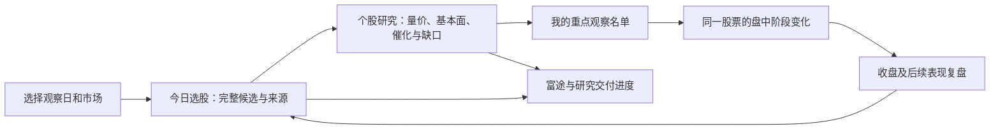

# V4 选股流程整合整改方案

状态：PROPOSAL。2026-11-12，只读梳理与方案交付；未实施业务改造、未部署、未修改调度或外部分组。方案不构成收益或交易有效性证明。

## 1. 能力目标

用户在 V4/8873 的同一工作流程中，完成“确定观察日和市场 → 看完整候选及入选理由 → 形成自己的重点观察名单 → 查看盘中变化 → 对照收盘和后续表现 → 确认富途与研究交付”。围绕股票和每天的任务组织功能，减少在研究面板、阶段选股、经理工作台、研报决策台和任务页之间核对日期、名单与状态。

建议日常主导航收敛为三个入口：**今日选股、个股研究、复盘验证**。盘前/盘中/收盘/次日准备是“今日选股”内的时间视图；交付进度和系统状态作为固定状态入口。原有策略、来源池和专业工具继续提供原能力，逐项迁入相应视图，完成替代验收后再调整旧入口的展示。

第一批建议优先 A 股，覆盖本轮用户实际遇到的公式差异、缺池和富途更新不透明问题；港股保留独立日历、池与规则，并复用同样的交互结构。

## 2. 约束和现状证据

### 固定规则

- 唯一源码/用户入口沿用 V4/8873。复用原数据、原计算 owner、API、标签与完成事件；整合视图只引用既有产物，不建立第二底板或平行 producer。
- A/HK 独立。观察日、候选来源日、行情时点、研究材料可用时点分别保留。历史补算、事后快照、自然结果明确区分。
- 所有合法可追溯的 A 股候选可进入既有阶段链。坏来源只隔离自身；缺失、有效空池、部分可用、来源过期不是同一种状态。200 行分页只影响展示，不截断阶段输入。
- 原公式、v1.9.2、各阶段模型与研究来源各保留判定、分数和口径。跨策略总分、权重和统一自动排序属于另一个需要实证验收的研究任务，本次方案不指定。
- 研究文字、主观关注标签不改变池资格、模型分数、BUY gate 或订单。未知保持未知。Vibe 8910 按既有例外保留原样。

### 已观察到的问题

| 问题 | 证据 | 对用户的影响 |
| --- | --- | --- |
| 导航按模块排列 | `apps/web/src/App.vue:183` 起已有阶段、D-1、研报、经理、任务、两类复盘及 Vibe 入口 | 用户要先理解系统结构，才能完成选股 |
| 多个工作台具有重叠职责 | `ManagerSelectionView.vue`、`manager-workbench/Workbench.vue`、`DailyResearchCommandView.vue` 与现有数值研究面板 | 同一名单、个股研究、进度和复盘分散 |
| 入选数量缺少就地解释 | 本轮原公式/v1.9.2/预选池差异调查 | 不易分清公式未命中、研究来源入池、数据不足或日期不同 |
| 某模块失败会影响独立来源 | 本轮 D12 复盘池被缺失 Stage7 连带阻断，随后历史回补 62 行 | 页面空白不能直接解释为没有股票 |
| 日更、页面、交付是不同完成层 | 现有每日研究交付 SOP 分别登记基础表、日包、API/UI、富途、Chat 与研究导入 | 用户难以知道“今天到底做完了什么” |
| 源码、候选与现役需要明确区分 | 当前 Main/API/Stage 分角色发布，本轮历史回补入口未作为自然链换版 | 源码修复不能直接等同于每天自动成功 |

证据范围：用户本轮截图与反馈、上述源文件、现有每日交付/阶段 SOP、本轮原公式对比及可选池恢复回执。前端身份接口在 2026-11-12 22:35:44 +08:00 读取成功，API release 为 `v4-workbench-quote-contract-20261112-r1-api`，响应 SHA256 `32adc1b8975d516c46f2a1c2307a99ec304d5b7e352c8a076cdc50c432b939fe`。这是入口身份读取，不证明所有模块均已上线或自然运行成功。未进行全站 UX、可访问性或性能认证，不给未经测量的体验评分。

复用 [已有港股经理工作台方案](manager-workbench-optimization-20261007.md) 中的分来源判断、按股票去重、时点区分和结果追溯；该文旧运行状态不作为当前状态证据。

## 3. 用户界面和工作流程

### 今日选股

首屏回答五件事：今天用哪天的数据；候选是否已生成；当前有哪些值得查看的股票及理由；相对上一有效版本发生什么变化；富途和研究交付做到哪里。

建议布局：顶栏固定观察日、市场、候选来源日与行情时间；一行简明进度；主体是同市场按证券去重的候选表；右侧或抽屉展开个股。详细来源池、运行日志、长 SHA、补算操作放入可展开的证据/系统区域。严重缺口仍在首屏显示，技术详情折叠不等于隐藏失败。

候选表默认列：代码名称、入选来源及理由、量价阶段、既有规则给出的观察条件/失效条件、研究摘要、主要风险/缺口、当日变化。没有合格字段就显示未知，条件栏不现场编造价格或建议。

筛选提供：原公式、v1.9.2、研报/公众号/复盘等来源、行业、已有信号、研究完成情况、用户关注状态。显示每个筛选的分母与日期。首页优先展示用户置顶和现有阶段结果，完整候选始终可查；展示优先级不改变阶段算法的完整输入或资格。

### 原公式与 v1.9.2 的差异直接可见

在同一个来源日和输入版本下查看“共同入选、仅原公式、仅 v1.9.2、尚未完成判断”。独立的研究来源标记另外保留，不能拿来源池总人数与公式人数混比。

每只股票展示已被原结果证明的差异原因：是否命中规则、哪些已知条件不满足、哪侧尚未计算/缺数据、是否来源日或输入版本不同。日期/输入不可比时先显示不可比原因；缺少逐条件证据时写“尚无条件明细”，不靠文字推测原因。多来源同时出现只表示覆盖重叠，不直接等于置信度增加。

### 个股研究

同一股票在不同入口打开同一份详情，保留来源和日期上下文。优先复用现有工作台/公司材料合同，整合为五组信息：

1. **量价结构**：前段建仓波/拉升波的现有判断、关键 K、已有大幅拉升、大阴线和结构破坏、当前相对锚的位置。阶段判断不自动升级为主力建仓证据。
2. **基本面与产业链**：利润来源、业绩兑现条件、卡点/替代难度、行业二筛及反证。
3. **催化与重大事项**：公告、研究观点、实控人意愿与能力、债务/质押等已知事实及待核线索。未知概率不伪造成数值。
4. **盘中证据**：原阶段结果和各自真实行情时间；自然结果与事后补选分开展示。
5. **判断与缺口**：原有规则/研究结论、冲突证据、尚缺什么、接下来观察什么。用户可记录自己的研究备注。

“重点关注、继续观察、待核实、暂不关注”是用户研究管理状态，不是新的自动买卖评级。关注数不设人为硬上限。表格中的一句摘要必须能展开查看对应事实和原证据。

### 盘中跟踪

沿用原八阶段和既有结果。对关注股票显示“本阶段相对上一阶段的变化”，而不要求反复在各张 Top10 表中找股票。阶段结果未覆盖某只关注股票时显示未覆盖，不能推断为已淘汰；阶段失败与股票不符合条件分开。

新增、保留、暂离当前结果、条件变化分别记录原因和时点。当前观察不能反写盘前冻结结论。原阶段未执行时显示未执行，事后补选只进入明确标记的回看/补选区域。

### 复盘验证

按同批名单贯通：候选 → 用户关注 → 原阶段入选 → 当日表现 → D+2/D+5。保留全名单与各层分母；未成熟、缺价、排除和有效样本分别统计。用户关注名单表现与原策略表现分开，不把手工挑选结果冒充模型整体收益。

漏选分析区分原规则未命中、数据/流程失败、以及事后才知道的新增信息；事后强势股不能倒灌盘前规则。页面整合改善使用效率，策略有效性需另按同输入、同日期范围的冻结评价证明。

## 4. 数据、状态和交付衔接

### 一个日期上下文，一份可追溯的组合视图

在既有日包/index/完成事件上组织组合视图，引用原产物而非复制原文或大表。组合键至少包括市场、观察日、来源日、阶段/截止时间、运行模式、各来源 generation/run/SHA。不同来源不强行假装同一个 generation；共同输入的原公式与 v1.9.2 比较必须有可比性证明。

统一证券身份；股票展示摘要可更新，但历史信号和阶段记录按各自日期/时点保留。各策略分数并列，不跨模型直接相加。公司材料按证券主体、事实有效期和材料可用时间复用。

第一批优先使用现有接口的只读组合；确有协议缺口时再在 V4 原 API 中补充字段或适配。具体路由和字段以实施时核对当前 owning contract 为准，不将文档中的拟议字段冒充已实现接口。

### 状态要让用户知道下一步

| 数据/执行事实 | 用户看到的含义 |
| --- | --- |
| 合格结果非空 | 可查看，注明来源日和更新时点 |
| 合格结果为空 | 已运行，本批 0 只 |
| 部分合格结果可用 | 可查看有效部分；列出缺失来源和影响 |
| 未开始/运行中 | 未执行或执行到哪个检查点 |
| 来源无效/日期不匹配/失败 | 哪个来源出了什么问题、影响哪一项、已有结果是否仍可用 |
| 旧结果或历史回补 | 明示旧来源日期/真实回补时间；不冒充当日自然完成 |

状态是多个维度：数据完整性、任务执行、API/UI读取、交付、自然验收分别存留。汇总状态不把任何失败改绿，也不因独立子池缺失阻断其他有效股票。时间字段使用真实墙钟和时区，不由文件 mtime 推断业务完成。

### 每日交付进度

在今日选股显示“基础数据 → 同版选股 → 完整名单/研究提示词 → 页面投影 → 富途 → 研究回包 → 接入”的分项状态与真实完成时间。按现有 SOP，名单和提示词应可先交，页面与后续任务各自续行；研究未完成不伪装成已完成，不无故阻断独立有效名单。

富途展示目标分组日期、来源批次、应有/实有数量、缺失/多余、实际最后成功回执。让用户能区分“候选没生成”“尚未同步”“同步失败”“部分同步”。导出和同步始终绑定所选批次，打开页面或点普通刷新不触发第三方写入。

复用既有交付机制，生成该批清单、当日表现、Drive 入口与可复制研究提示词；Chat 回包分别显示已收到、已校验、已导入、页面可见及缺件。既有资料和 Drive ID 复用，只处理增量。具体外部执行仍遵循当前授权，不在本次方案中新增自动化、发送研究任务或修改分组。

## 5. 分批实施及验收

| 批次 | 实际交付 | 通过条件 |
| --- | --- | --- |
| 1：日期、来源和完成状态 | 既有模块 owner/产物/API/页面地图；选定现役组合基线；统一日期栏与交付进度；明确已审但未集成的修复 | 能区分当日新选、旧名单加新行情、有效空池、未执行、部分可用；任一独立坏来源不清空有效结果；源码/部署/自然成功不混淆 |
| 2：今日选股与公式比较 | 在原入口内收拢候选、筛选、来源标记与原公式/v1.9.2对比；后台保留原来源池 | 同一上下文下，完整候选/排名与原 owner 一致，差异可解释；超过200行的真实完整输入不被展示分页截断；A/HK不混入 |
| 3：统一个股研究与盘中跟踪 | 原研究详情统一打开；关注状态与原阶段变化关联；专业工具迁入详情 | 从今日名单不超过两次操作能打开同股完整研究和来源；关注状态不影响原资格/分数；无证据字段不补0或编造；历史结论不被后续覆盖 |
| 4：复盘、交付与旧入口收敛 | 同批名单复盘、交付状态、原完成事件刷新；旧入口迁移映射 | 复盘与交付绑定同批身份；成熟/缺失分母正确；富途未更新能指出实际断点；替代流程验收后才调整旧入口展示，保留旧链接兼容 |

第一批即可改善每天“看哪一天、看哪个名单、哪里卡住”的体验。各批做对应最小行为复现、必要检查和一次独立 Reviewer；已有同条件 PASS 复用。先用三个代表样本核用户流程，已知异常应覆盖；机械核对全名单、身份和分页边界。抽检不冒充全站/逐股验收，不为页面整合重跑模型或全历史。

UI 目标包括：窄屏代码/名称/理由可读，次要宽字段进抽屉；首屏候选先加载，原图和重型研究详情按需加载；刷新保留日期、市场和筛选。具体性能基线实施前测量，当前不承诺未经实测的加载秒数。

## 6. 本轮不承担的变更

本轮只交方案。尚未实施页面替换、删除模块、迁移数据、停用服务、整合分支、部署自然流程、修改富途/Drive/Chat、训练新模型、发明统一总分或改 BUY 门禁。原 8910 例外、原始产物及已有有效工作全部保留。

## 7. 待定事项与交接

默认建议：A 股优先、三主入口、保留所有来源身份、沿用现有算法、手工研究关注状态与模型判断分离。没有阻止本轮方案交付的待答问题；正式实施时再冻结第一批允许路径、Writer/Reviewer、现役基线和唯一通过信号。

跨模块改造前需核清：现有各详情和日包哪些字段可直接复用、未部署修复的依赖、用户关注记录现有 owner 能否承载、旧专业入口是否存在本方案未覆盖的必要功能。确认缺口后在原模块扩展，不预先搭建新平台或写入新权威底表。

建议下一步交付第一批的真实字段/模块映射及“今日选股”页面线框，随后按批实施和验收。本文是方案，尚无本方案的实施/独审/部署/自然验收 PASS。

相关依据：[每日研究交付规程](../operations/DAILY_RESEARCH_DELIVERY_SOP.md)、[阶段选股规程](../operations/STAGE_SELECTION_SOP.md)、本项目 AGENTS.md。

RESEARCH_ONLY=true；production_allowed=false；buy_gate_updated=false；orders_sent=false。
