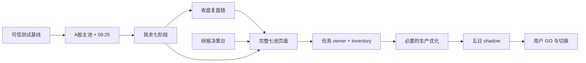

# V3.5 最小垂直等价重构完成计划

> **Required sub-skill:** 执行本计划时使用 `superpowers:executing-plans`；每个业务切片只允许一个代码写入者。

**状态：** `PLAN_WRITTEN / NOT_APPROVED`

**目标：** 在旧 V3 只读、V3.5 独立生产的前提下，按依赖顺序完成 `原始输入 → producer/model → artifact → manifest/receipt → exact-date API → V3 原页面行为`；全部切片通过五日 shadow 后，才进入用户最终 GO。

**方法：** 不再扩大治理体系，也不推倒当前工程底座。保留已经验证的日历、dispatcher、原子存储、路径安全、tdxpy/V1.1 adapter 和 parity receipt；把当前候选实现逐个放回 V3 图谱规定的真实生产链中验收。默认一次只闭环一个页面/业务切片。

**技术栈：** Python 3.14、FastAPI、pytest、Vue 3、TypeScript、Vitest、Vite、PowerShell、JSON/SHA-256。

---

## 1. OpenAI 官方建议及本计划采用方式

截至 2026-08-02，OpenAI 官方没有发布一篇题为“GPT-5.6 如何写实施计划”的专门模板。本计划采用能够在官方资料中直接核实的建议：

- [GPT-5.6 官方介绍](https://openai.com/index/gpt-5-6/)与[模型帮助页](https://help.openai.com/en/articles/20001354-gpt-56-in-chatgpt)把 Sol 定位为最强代码/复杂任务模型，把 Terra 定位为能力、速度、成本平衡，把 Luna 定位为更快的轻量任务模型。因此，困难裁决交给 Sol，复杂实现可交给 Terra，窄范围只读查找才交给 Luna。
- [A practical guide to building agents](https://cdn.openai.com/business-guides-and-resources/a-practical-guide-to-building-agents.pdf)建议先建立评价基线、先最大化单代理能力、渐进增加复杂度，并把每一步写成明确动作和输出。本计划默认单代理、单写入者；多模型是异常升级路径，不是日常仪式。
- [Unrolling the Codex agent loop](https://openai.com/index/unrolling-the-codex-agent-loop/)说明有效循环是“输入 → 推理 → 工具动作 → 新证据 → 继续或结束”。因此每个切片都固定输入、执行动作、机器证据和退出条件，不另建长期自治编排层。
- [Introducing GPT-5 for developers](https://openai.com/index/introducing-gpt-5-for-developers/)强调可见 preamble、工具链执行和错误恢复。本计划要求开始前用短状态块说明范围，执行中只报告新证据，不以长报告代替代码结果。

**明确不采用：** 为展示“模型能力”而默认启动四个代理、按文件拆出大量微任务、建立新的总控框架、用产出 token/报告数量衡量进度。

---

## 2. 当前事实基线

执行开始时先复核下列事实；任何变化只更新切片冻结记录，不重写本计划的目标：

- 当前观察 HEAD：`9c7d0941a9caad76ca33b410028245a4b9ea1dc5`。
- 当前用户所有未跟踪文件：`docs/superpowers/plans/2026-07-31-v35-runtime-and-review-remediation.md`；禁止修改、删除、提交。
- 当前 inventory v4：336 个源文件、90 个入口、69 个 runtime 记录、11 个 feature，共 506 条；`COMPLETE=0`，全部仍是 `CANNOT_CONFIRM`。
- 当前全局声明：`business_parity_verified=false`、`ui_verified=false`、`ready_to_replace=false`、`deployed=false`。
- 已完成的是工程候选底座，不是业务接管：图谱、合同、日历、dispatcher、模式隔离、原子/路径安全、tdxpy 09:25 adapter、部分 producer 和测试可以保留。
- 仍未闭环：真实每日 producer、完整八阶段、收盘复盘 publish/verify、V3 研报台界面、完整多池来源、绝大多数 task owner、页面严格 PASS、五日 shadow。
- 当前 Vue 全量测试有两个 5 秒超时；typecheck/build 通过；Python focused close-review 测试通过，但全量 pytest 在最近一次 180 秒窗口内未完成，不能宣称全量 PASS。
- 旧 V3、Windows Tasks、BUY gate、真实订单均不在本批次写入范围；始终保持 `production_allowed=false`、`buy_gate_updated=false`、`orders_sent=false`。

旧计划 `2026-08-02-v35-equivalent-rebuild-corrective-plan.md` 的业务目标继续有效；本计划只替换其执行顺序和粒度。关键修正是：

1. 不再要求尚依赖 Stage7、复盘、研报、港股和微信 producer 的“完整预选池页面”提前通过。
2. 先完成 09:25 所需的 A 股上游主池，再完成八阶段和复盘/研报 producer，最后验收七个独立池的总页面。
3. `CANNOT_CONFIRM`、`EXPECTED_FAIL_NOT_PARITY`、HTTP 200、离线文件或测试通过都不能替代严格业务 PASS。

---

## 3. 全局范围锁

```text
GOAL: 每次只让一个图谱支持的 V3 页面/业务切片从空 V3.5 数据根独立生产并严格等价
WRITER: 默认 Codex/Sol 单一写入者；如切换 Terra，则 Terra 成为该切片唯一写入者，Sol 只读主控
ALLOWED_PATHS: 当前切片列出的 V3.5 production、tests、既有 contracts/migration 精确记录、.runtime/data 内切片产物及 .runtime/evidence/parity
FORBIDDEN_PATHS: 旧 V3、用户未跟踪计划、真实交易配置、BUY gate、订单、Windows Tasks、切片外业务文件
PASS_SIGNAL: artifact/manifest、API、内置浏览器页面三车道全部 PASS，focused tests 通过，安全标志不变
STOP_RULE: 三车道任一 FAIL/CANNOT_CONFIRM 即停止该切片；只有权限/凭证/不可逆动作、图谱语义冲突或指定模型路由不可用才询问用户
```

### 严格等价定义

“禁止自创”不是禁止写新工程代码，而是禁止改变下列 V3 语义：原始来源、截止时间、日期角色、模型/阈值/排序、股票池边界、页面入口、区块顺序、字段来源和交互。

“等价”不是代码逐行相同，也不是截图像素相同；它要求同一冻结输入下，V3 与 V3.5 的业务字段、股票集合/顺序、缺失状态、API 日期语义和原页面可见行为一致。V3 最终 API/页面输出只能是 expected-answer oracle，不得成为 V3.5 LIVE 输入。

### 每个切片唯一允许的执行循环

1. 冻结图谱节点、旧源原始字节 SHA、原始输入 SHA、业务日期、cutoff、当前 HEAD、页面 URL/视口和预期结果。
2. 先写一个端到端失败测试，证明空 V3.5 数据根不能满足该切片。
3. 只移植这条 V3 producer/model 链；不顺手抽象相邻功能。
4. focused test 绿后才运行 API 和页面；不在每次文件保存后跑全库。
5. artifact/manifest、API、页面分别裁决；三者全部 PASS 才写一份既有 `ParityReceipt`。
6. Reviewer 只读复核一次；主控复核命令和产物后提交当前切片。
7. 向用户展示 V3/V3.5 同日期页面和差异表，停止等待页面验收；不得自动开始下一个页面切片。

### 卡帕西十原则落地

| 原则 | 本计划的机器化约束 |
|---|---|
| 1. 单一目标 | 一个切片只验收一个页面或一条 producer-consumer 链。 |
| 2. 冻结输入 | 记录 graph/source/raw-input/code/date/cutoff/viewport SHA。 |
| 3. 固定评价 | 修改代码前固定字段、行数、顺序、DOM 和拒绝条件；不得改 oracle 迎合结果。 |
| 4. 单一变量 | 每个提交只改变一个业务链；性能优化与业务迁移分开。 |
| 5. 可证伪假设 | 每个任务写明预测、PASS 和 REJECT；失败不能包装成部分成功。 |
| 6. 简单优先 | 直接移植 V3 权威 producer，复用现有 store/receipt；禁止新平行模型和新治理层。 |
| 7. Canary 优先 | 先跑一个冻结日期和空数据根，再扩到日期矩阵和五日 shadow。 |
| 8. 胜者保留 | 已过的底座不重写；失败仅撤回当前切片，不全库回滚，也不叠加补丁。 |
| 9. 最小账本 | 每切片一份 receipt、一组测试输出、一对截图；不再生成重复审计报告。 |
| 10. 真实阻塞才停 | 普通 bug 继续修；只有权限、凭证、不可逆动作、图谱冲突或模型路由缺失才询问。 |

---

## 4. 模型能力分工

### 默认单模型模式

| 角色 | 职责 | 写入边界 |
|---|---|---|
| Codex / GPT-5.6 Sol | 冻结目标、读 V3 图谱、实现最小补丁、运行测试、核对 receipt、最终裁决 | 默认是唯一写入者 |
| 确定性 Python/测试 | SHA、行数、集合/顺序、日期、状态、性能和 PASS/FAIL | 只写切片指定的临时数据根与 evidence |

### 条件升级模式

- 只有一个切片同时跨越三个以上 production 模块且 Sol 两条单变量路线均失败时，才把整个切片交给 GPT-5.6 Terra；Terra 成为该切片唯一代码写入者，Sol 不再修改同一文件集。
- 只有 V3 图谱不能解释具体 source/producer/consumer 时，才调用 Luna/Explorer 做一次窄范围只读血缘查找；输出必须包含路径、行号、SHA 和 `CANNOT_CONFIRM`，不得写代码。
- 只有切片三车道均形成候选 PASS 后，才调用一个 Reviewer 做一次只读审计；不在开发循环中反复启动审计代理。
- Spark/Haiku 仅可对隔离 evidence 做字段清单、去重和重复身份检查；不得解释业务或修改正式代码。
- 指定模型路由不可用时记录 `MODEL_ROUTE_UNAVAILABLE` 并在写代码前停止；不得用别名或其他模型冒充。
- 禁止多个模型并行修改同一文件集；禁止把子代理的 PASS 直接当作主控验收。

这套分工保留了能力差异，但日常路径仍是一个写入者，避免代理协调成本超过重构本身。

---

## 5. 依赖正确的实施顺序



研报切片与八阶段代码可以逻辑独立，但仍按单写入者顺序执行；不并行写 `App.vue`。

---

## Task 1：恢复可信测试基线，不改业务答案

**目标：** 当前候选代码先形成可重复的绿灯基线，避免后续把已有超时误判为新切片回归。

**允许修改：**

- `apps/web/src/App.spec.ts`
- 仅当失败证明是共享日期/路由状态根因时：`apps/web/src/App.vue`
- 仅当测试基础设施本身有确定性缺陷时：`apps/web/src/test/setup.ts`

**步骤：**

1. 冻结当前两个失败用例的完整错误、调用序列和默认 5 秒超时：research exact-date 用例与 A/H close-review exact-date 用例。
2. 单独重跑每个用例三次，判断是未清理异步状态、fetch mock 分支遗漏，还是 production 状态竞争。
3. 先写能稳定重现的失败断言；只修一个根因。禁止提高 timeout、添加 sleep 或删除断言。
4. 运行：

   ```powershell
   Set-Location apps/web
   npm test -- src/App.spec.ts
   npm run typecheck
   npm run build
   ```

5. 再运行三次 `npm test -- src/App.spec.ts`；三次都通过才提交。

**PASS：** 24 个 Vue 用例在默认超时内稳定通过，typecheck/build 通过，production 页面语义未改变。

**REJECT：** 通过放宽超时、隐藏 loading、减少 exact-date 断言或改变研究/复盘业务答案制造绿灯。

**提交：** 一个测试基线提交；本任务不生成 parity receipt，不提升 inventory。

---

## Task 2：首个严格垂直切片——A 股主池到 09:25 页面

**唯一目标：** 从空临时 V3.5 数据根独立得到 20260730 A 股 09:25 结果，并在原 stage workbench 页面可见。

**V3 权威链：** `a_d1_premarket_pool → tdxpy exact-date 09:25 auction → a_share_v1_1_price_volume_adapter → candidate → selected`。Futu 不得替换 tdxpy。

**冻结 oracle：** requested 147、source 146、缺失 `A.300333`、candidate 50、selected 50；冻结快照变化只能报 SHA drift，不能改预期。

**允许修改：**

- `domains/preselection_materializer.py`
- `ops/materialize_preselection.py`
- `domains/stage_input_producer.py`
- `infrastructure/tdx_minute_replay_provider.py`
- `domains/opening_second_filter.py`
- `domains/stage_scoring.py`
- `domains/stages.py`
- `infrastructure/preselection_pool_store.py`
- `infrastructure/stage_store.py`
- `apps/api/v35_api/app.py`
- `apps/web/src/App.vue`
- `apps/web/src/App.spec.ts`
- `tests/test_task5_preselection_producers.py`
- `tests/test_stage_input_producer.py`
- `tests/test_stage_0925_frozen_regression.py`
- `tests/test_stage_0925_v11_adapter_parity.py`
- 新增 `tests/test_stage_0925_vertical_parity.py`

**测试先行：** 新端到端测试必须在 `tmp_path` 空数据根运行，并同时断言：

```python
assert pool["pool_id"] == "a_d1_premarket_pool"
assert workbench["markets"]["A"]["requested_count"] == 147
assert workbench["markets"]["A"]["source_rows"] == 146
assert workbench["markets"]["A"]["missing_symbols"] == ["A.300333"]
assert workbench["markets"]["A"]["candidate_count"] == 50
assert workbench["selected_a_rows"] == 50
assert result["production_allowed"] is False
assert result["buy_gate_updated"] is False
assert result["orders_sent"] is False
```

并拒绝 `legacy_partial_migration`、reference import、8771 HTTP、`v3_system` runtime path 和跨日 fallback。

**实施步骤：**

1. 用图谱和旧源 SHA 核对 A 主池的真实 raw source、cutoff、producer 与字段映射；只读旧 V3。
2. 先运行新端到端测试，保存预期失败。
3. 让 `ops/materialize_preselection.py` 只从冻结 raw source 生成 A 主池并写入临时 V3.5 root。
4. 让 stage producer 从该主池调用既有 tdxpy provider 和 V1.1 adapter；不得导入 V3 最终 stage JSON。
5. 复用现有 `StageStore` 和 `ParityReceiptStore`，不增加新 contract/schema；receipt 固定写入 `.runtime/data/parity/20260730/stage.workbench/stage_0925_a/receipt.json`，截图和对比表写入 `.runtime/evidence/parity`。
6. focused tests：

   ```powershell
   $env:PYTEST_DISABLE_PLUGIN_AUTOLOAD='1'
   python -m pytest -q tests/test_task5_preselection_producers.py tests/test_stage_input_producer.py tests/test_stage_0925_frozen_regression.py tests/test_stage_0925_v11_adapter_parity.py tests/test_stage_0925_vertical_parity.py
   ```

7. 启动 V3.5 候选服务，只读取隔离临时数据根；调用 `GET /api/v3/workbench/stage?date=20260730&stage=STAGE_0925&limit=50`，核对 exact-date、50 行、代码和顺序。
8. 使用内置浏览器以 V3 首次冻结的相同视口打开 8771 与 8872；只验收 A 股 09:25 区块的标题、状态、50 行、来源字段、阶段切换、loading、overflow 和 console。
9. artifact/manifest、API、页面三车道全 PASS 后才 seal receipt；Reviewer 只读复核一次，主控复核后提交。

**PASS：** 空数据根独立生产 147/146/1 缺失/50/50；三车道均为 `PASS`；页面没有“source rows 0”。

**REJECT：** 任何 final-output import、Futu 替代、跨日回退、改阈值/排序、页面假数据、`CANNOT_CONFIRM` 或 built-in browser 未验收。

**用户验收点 1：** 展示 20260730 V3/V3.5 A 股 09:25 区块与机器计数，停止等待用户确认。

---

## Task 3：补齐其余七阶段，并完成八阶段工作台

**唯一目标：** 复用 Task 2 的上游池和 stage 框架，移植其余七个 V3 阶段，不改变模型、阈值、排序或 A/HK 边界。

**阶段矩阵：**

- `STAGE_0930_0935`
- `STAGE_0935_0940`
- `STAGE_0940_0945`
- `STAGE_0945_1030`
- `STAGE_1300_1315`
- `STAGE_1445_1500`
- `STAGE_1545_1555`（仅 HK）

**允许修改：** `contracts/stages.py`、`domains/stage_input_producer.py`、`domains/stage_scoring.py`、`domains/stages.py`、`infrastructure/tdx_minute_replay_provider.py`、`infrastructure/stage_quote_provider.py`、`infrastructure/stage_store.py`、`apps/api/v35_api/app.py`、`apps/web/src/App.vue`、`apps/web/src/App.spec.ts`，以及对应 `tests/test_stage_*.py`；不得修改预选池 producer。

**步骤：**

1. 为七阶段建立一个参数化失败测试，逐项冻结 V3 raw source SHA、bar window、cutoff、market scope、expected row identities/order。
2. 每次只启用一个 stage 定义，focused test 通过后保留，再处理下一个；失败阶段不得通过修改共同 oracle 影响已通过阶段。
3. A/HK provider 失败状态分开：A 失败不得隐藏 HK，HK 失败不得隐藏 A；最后阶段不得出现 A 股。
4. API exact-date 必须按选择的 stage 返回真实 artifact；`POST ensure` 只物化指定日期/阶段，不更新其他日期 latest。
5. Vue 恢复 V3 八阶段导航、股票行、来源和状态行为，不重新设计 workbench 信息架构。
6. 运行：

   ```powershell
   $env:PYTEST_DISABLE_PLUGIN_AUTOLOAD='1'
   python -m pytest -q tests/test_stage_runs.py tests/test_stage_quote_provider.py tests/test_tdx_minute_replay_provider.py tests/test_stage_scoring.py tests/test_close_review_producer.py
   Set-Location apps/web
   npm test -- src/App.spec.ts
   npm run typecheck
   npm run build
   ```

7. 内置浏览器逐个切换八阶段，记录真实行数、股票代码、状态、loading/console；八阶段共用一份 `stage.workbench/eight_stages` receipt，但每个 stage 有独立车道结果。

**PASS：** 八阶段都由相同日期 raw source 独立生成，API/页面切换无跨日或空壳，A/HK 状态局部化。

**REJECT：** 从旧最终 artifact 导入、自动跨日补齐、一个市场状态覆盖另一个、缺一个 stage 仍整体 PASS。

**用户验收点 2：** 展示八阶段切换和真实股票行，停止等待确认。

---

## Task 4：完成收盘复盘、模型、发布与页面验证链

**唯一目标：** 把当前 10 节点候选链从 `PARTIAL_READY/UI_NOT_VERIFIED` 推到与 V3 同日语义一致；证据缺失时显示 V3 等价缺失状态，不生成解释性 prose。

**权威顺序：** `FUPAN_CLOSE_MATERIALS → FUPAN_REVIEW_START → FUPAN_A_SHARE_STRUCTURE → FUPAN_VIDEO_CHECK → FUPAN_VIDEO_DOWNLOAD_ASR → FUPAN_STOCKDICT → FUPAN_VIDEO_TABLE_OCR_ALIGN → FUPAN_VIDEO_GAP → FUPAN_V3_PUBLISH → FUPAN_8771_VERIFY`。

**允许修改：**

- `domains/a_share_review.py`
- `domains/close_review.py`
- `domains/close_review_chain.py`
- `domains/review_envelope.py`
- `ops/build_a_share_close_review.py`
- `ops/build_close_review.py`
- `domains/bilibili_fupan.py`
- `domains/video_ocr_alignment.py`
- `domains/video_gap_audit.py`
- `ops/check_bilibili_fupan.py`
- `ops/capture_bilibili_fupan.py`
- `ops/build_bilibili_stockdict.py`
- `ops/build_video_ocr_alignment.py`
- `ops/build_video_gap_audit.py`
- `infrastructure/a_share_review_store.py`
- `infrastructure/review_store.py`
- `apps/api/v35_api/review_router.py`
- `apps/web/src/components/review/AshareReviewPanel.vue`
- `apps/web/src/components/review/HkCloseReviewPanel.vue`
- `apps/web/src/components/review/ReviewEvidencePanel.vue`
- `apps/web/src/App.vue`
- `apps/web/src/App.spec.ts`
- `tests/test_a_share_review.py`
- `tests/test_close_review_chain.py`
- `tests/test_close_review_producer.py`
- `tests/test_close_review_slice.py`
- `tests/test_review_api_contract.py`
- `tests/test_bilibili_fupan.py`
- `tests/test_bilibili_capture.py`
- `tests/test_bilibili_stockdict.py`
- `tests/test_video_ocr_alignment.py`
- `tests/test_video_gap_audit.py`

**步骤：**

1. 从图谱冻结 V3 对应模型身份、源路径/SHA、节点时序、A/H 角色字段、publish artifact 和页面 DOM；不得以当前 V3.5 字段反推 V3 设计。
2. 建立两个 canary：20260731 exact-date 防跨日/缺失态；以及图谱中最近一个“10 个 raw-source 节点均有 SHA”的完整日期。完整日期由脚本按节点齐备性选择，禁止人工挑有利结果。
3. 写失败测试，明确 `FUPAN_V3_PUBLISH` 不能硬编码 `PARTIAL_READY`，`FUPAN_8771_VERIFY` 不能在页面未验收时返回准备完成。
4. 逐节点接真实 producer 输出；每个节点只接受同一 business date 和已冻结 source SHA。模型只消费 V3 图谱规定字段，不允许 LLM 补写“大局/主线/锚/升级条件”。
5. publish 只在依赖满足时写 artifact/manifest；缺失依赖写类型化 `NOT_MATERIALIZED`，并让页面结束 loading。
6. API `GET /api/v3/review?date=YYYYMMDD` 保持 A/H 分离状态、模型 identity、source links 和 exact-date。
7. Vue 恢复 V3 复盘页区块顺序、来源、模型状态、股票角色和视频/证据交互；不使用当前自创摘要卡替代原结构。
8. focused Python、Vue、typecheck、build 全过后，用内置浏览器对比完整 canary 与 20260731 缺失 canary。

**PASS：** 完整 canary 的 10 节点同日闭环；20260731 不跨日借料；API 和原页面行为匹配；模型来源清楚；三车道 PASS。

**REJECT：** LLM 自写市场结论、跨日视频、隐藏 A/H 一侧失败、publish 空壳、页面只显示 `cannot_confirm` 诊断而无 V3 可见信息。

**用户验收点 3：** 展示复盘模型来源、A/H 状态、同日视频/缺失态和 V3 区块顺序，停止等待确认。

---

## Task 5：按 V3 原信息架构完成研报决策台

**唯一目标：** 从 V3 图谱规定的原始来源独立生成 exact-date 研报档案，并恢复 V3 `priority / feed / context` 三栏及原交互。

**允许修改：**

- `contracts/research.py`
- `domains/research.py`
- `infrastructure/research_store.py`
- `ops/run_hourly_research.py`
- `apps/api/v35_api/research_router.py`
- `apps/web/src/api/research.ts`
- `apps/web/src/contracts/research.ts`
- `apps/web/src/views/ResearchView.vue`
- `apps/web/src/views/ResearchView.spec.ts`
- `apps/web/src/App.spec.ts`
- `tests/test_hourly_research_runner.py`
- `tests/test_research_archive.py`
- `tests/test_research_graph_contract.py`

**步骤：**

1. 冻结 finance、ZSXQ、morning news、WeChat、hourly delta 的 V3 raw paths/SHA、cutoff、六字段去重键和三个时区字段；`LEGACY_FINAL_API` 仅作为 oracle。
2. 在空数据根写失败测试：相同 raw source/cutoff 应产生 V3 expected stock/article identities；没有 raw source 时必须 `NOT_MATERIALIZED`，不得退到 latest。
3. 直接移植 V3 producer 与去重语义；不设人工股票数量上限，不以现有 V3.5 的 336/205 结果倒推规则。
4. 严格保留：

   - `GET /api/v3/research/articles?archive_date=YYYYMMDD`
   - `GET /api/v3/research/articles/latest`
   - offset-aware `published_at`、`collected_at`、`first_seen_at`
   - Asia/Shanghai 展示不改变 archive date

5. 把 `ResearchView.vue` 恢复为 V3 的入口、三栏、source tabs、事件定位、timeline filter、original link 和股票池边界；允许工程组件化，不允许改变信息架构。
6. 固定 API 矩阵：20260730、20260725 周末、20260217 休市、exact miss、explicit latest；REPLAY/BACKFILL 不更新 latest。
7. 运行 focused tests、Vue、typecheck/build；内置浏览器用同日期/视口对比 DOM 标题、来源数、文章/股票 identities、交互和 console。

**PASS：** raw producer 独立 materialize；exact/latest 不冒充；三个时间字段不漂移；V3 三栏和交互恢复；三车道 PASS。

**REJECT：** 导入最终研报 JSON、人工限制池大小、跨日 fallback、摘要卡替代三栏、只有 HTTP 200 没有页面信息源。

**用户验收点 4：** 展示 V3/V3.5 研报台同日三栏、来源、事件定位和股票池，停止等待确认。

---

## Task 6：完成剩余 producer 后再验收七个独立预选池

**唯一目标：** 在 Task 2–5 的真实 producer 已存在后，完成 Stage7/分时、复盘观察、白毛、港股通 D-1、微信公众号等剩余来源，并按 V3 原顺序独立呈现七池。

**固定池边界与顺序：**

1. `a_d1_premarket_pool`
2. `a_d1_fupan_watchlist_pool`
3. `a_d1_stage7_fenshi_review_pool`
4. `a_share_research_recommendation_pool`
5. `a_share_baimao_research_map`
6. `hkconnect_d1_top100`
7. `wechat_public_account_v3_preselect`

**允许修改：** `domains/preselection_materializer.py`、`ops/materialize_preselection.py`、`infrastructure/preselection_pool_store.py`、`infrastructure/preselection_overlay_store.py`、`apps/api/v35_api/app.py`、`apps/web/src/App.vue`、`apps/web/src/App.spec.ts`、`tests/test_preselection_slice.py`、`tests/test_preselection_optional_pools.py`、`tests/test_task5_preselection_producers.py`。如果读图谱后发现 raw producer 位于此清单之外，必须先补充当前切片的范围锁，不能直接跨目录写入。

**步骤：**

1. 每个池分别冻结 graph ids、raw source SHA、signal/target date、cutoff、producer、消费者和 V3 oracle；不得用旧 `/preselection-pools` 最终响应当 LIVE 输入。
2. 按上面顺序逐池写失败测试并移植 producer；一个池通过后保留，不把其他池的缺失合并成统一池。
3. `wechat_public_account_v3_preselect` 和白毛池保持 `RESEARCH_ONLY / NO_BUY_GATE`，不得进入 canonical 主池或 stage input。
4. 20260730 的 19/64/70/6/0/100/43 只作为当前冻结 oracle；只有同 raw source/cutoff 重放一致时才 PASS，source SHA drift 时停止该池并重新冻结，不改预期迎合新数据。
5. API 返回七个独立 group、各自 provenance/status；页面恢复 V3 分组顺序、名称、来源和展开/收起行为，不合并展示。
6. 空数据根 canary、focused tests、Vue/typecheck/build、内置浏览器通过后，写 `preselection.pools/seven_independent_pools` receipt。

**PASS：** 七池均由各自 producer 产生并保持边界；页面可见真实行和来源；缺失池局部可见，不隐藏其他池；三车道 PASS。

**REJECT：** read-time synthesis、final API import、`legacy_partial_migration`、池合并、research-only 行进入正式阶段、用某个已有日期文件伪装每日生产。

**用户验收点 5：** 展示七池分组、真实数量、来源与展开交互，停止等待确认。

---

## Task 7：闭合剩余可达任务、入口和 inventory

**唯一目标：** 业务页面切片已通过后，给每个可达图谱记录分配一个真实 V3.5 producer/consumer owner；不再用 disabled mapping 冒充迁移。

**允许修改：** `contracts/runtime_workloads.json`、`infrastructure/scheduling/dispatcher.py`、`ops/run_dispatcher.py`、任务状态 API/测试、`contracts/migration/v35_replacement_inventory_v4.json` 中当前切片的精确记录，以及对应真实 producer command。

**步骤：**

1. 对 35 个规范任务、36 个实际 Windows Tasks、34 个 timeline node、69 个 runtime records 做唯一 owner 映射；解释重复/alias，但不注册或关闭 Windows Tasks。
2. 只有已经在 Task 2–6 形成 artifact/receipt 的 workload 才能启用 command；其余保持 typed blocked，不能写空 artifact。
3. 每个 workload 固定 `market_scope`、`session_requirement`、scheduled/business/signal/target date roles，以及 LIVE/REPLAY/BACKFILL。
4. 复跑两个 dispatcher 并发、alias、非交易日、半日市、跨市场部分可用和 mode isolation 测试。
5. 三个 orphan loader 只有图谱证明页面可达才实现；仍不可达则保留 `COMPAT_NON_EXECUTING`，不得按名称猜功能，也不得未经用户批准 REMOVE。
6. inventory 逐条提升；一条记录必须绑定旧 SHA、graph ids、replacement path、test、artifact、receipt、API/page（适用时）。禁止批量把 506 条改成 COMPLETE。

**PASS：** 所有可达旧任务有唯一、真实、可 dry-run/replay 的 owner；无重复执行或时段遗漏；reachable records 无阻塞 `CANNOT_CONFIRM`；不可达记录有可机器检查的 COMPAT 证据。

**REJECT：** mapping-only、disabled placeholder 被计为完成、无产物 command、自动跨日补跑、REPLAY/BACKFILL 更新 live/latest、Windows Task 变更。

---

## Task 8：只做被测量证明必要的生产级优化

**唯一目标：** 在业务语义已封存后消除实际性能/可靠性缺口；如果当前基线满足门槛，`NO_CHANGE_REQUIRED` 是合格结果。

**允许候选：** 现有原子写、SHA/manifest/receipt、幂等占位、路径逃逸、连接复用、分页收敛、内容寻址缓存。禁止新架构、队列、重试/DLQ、模型或来源优先级调整。

**步骤：**

1. 每项优化单独冻结生产规模输入、V3 成功耗时基线、V3.5 before、下游时隙、输出 semantic SHA 和拒绝阈值。
2. 一次只改一个变量；先小样本 canary，再生产规模 benchmark。
3. 输出 SHA、股票集合/顺序、模型/阈值、池边界或日期语义任一变化即撤回当前优化。
4. 只保留“结果相同且不慢于冻结 V3 成功基线、不越过下游时隙”的修改。
5. 不新增 coverage 门槛，不做 Playwright 像素矩阵，不顺手清理无关代码。

**PASS：** 每个保留修改有 before/after receipt 和不变业务 SHA；没有实际缺口时输出 `NO_CHANGE_REQUIRED`。

---

## Task 9：全量门禁与五个合格交易日 shadow

**唯一目标：** 证明 V3.5 能持续每日独立生产，而不是只复现一个历史日期。

**全量门禁：**

```powershell
$env:PYTEST_DISABLE_PLUGIN_AUTOLOAD='1'
python -m pytest -q
Set-Location apps/web
npm test
npm run typecheck
npm run build
```

此外运行：零 V3 runtime dependency、路径逃逸/tamper、日期矩阵、dispatcher 并发、LIVE/REPLAY/BACKFILL、安全标志检查。全量 pytest 允许真实完成，不再用 180 秒中断结果冒充 PASS 或 FAIL。

**五日规则：**

1. V3 保持原状；V3.5 shadow-only，禁止写 V3、BUY gate、订单和 Windows Tasks。
2. 连续五个合格交易日，在每个 due slot 使用同采集时点或同冻结外部输入比较 producer、artifact/manifest、API、真实页面行/分组/交互。
3. 每日内置浏览器使用相同日期、URL 语义和冻结视口；核对 loading、横向 overflow、console 和来源可见性，不做像素相等。
4. 任一关键差异、重复执行、跨日数据或未解释空池使当日失败；修复同一根因后，五日计数从 0 重新开始。
5. 五日结果只写一张最终表和每日 receipt，不写重复叙事报告。

**PASS：** 五个连续合格日全部严格 PASS；506 条 inventory 具有机器可检查终态；`ready_to_replace` 仍保持 false，等待用户 GO。

---

## Task 10：用户最终 GO 与可回滚切换

**前置条件：** 用户收到并验收：终态 inventory、任务/feature 覆盖、五日表、性能、页面截图、风险和回滚点。

**GO 前：** `INTEGRATED/DEPLOYED/READY_TO_REPLACE=false`；不修改 Windows Tasks，不停止 V3。

**用户明确 GO 后才执行：**

1. 导出旧任务定义与原始字节 SHA。
2. 注册一个禁用的 V3.5 dispatcher，验证命令、账户和权限。
3. 启用 V3.5 dispatcher，再禁用对应 V3 tasks；不得反序造成调度空窗。
4. 核对 health、receipt、日期、池、模型和页面；任一失败立即禁用 V3.5 并用已导出定义恢复 V3。
5. V3 禁用后保留至少 10 个交易日；删除旧代码/任务必须再次单独批准。

**安全边界：** 服务切换不等于交易授权；仍保持 `production_allowed=false`、`buy_gate_updated=false`、`orders_sent=false`。

---

## 6. 固定验收矩阵

| 类别 | 固定样本/检查 |
|---|---|
| 日历 | 20260730 全日、20260725 周末、20260217 休市、20260701 A/HK 不对称、20261224 半日早盘/午后/收盘后、20270104 未知日期 |
| 数据 | raw-source-only LIVE、exact/latest 隔离、跨日拒绝、外部输入只读、symlink/junction 逃逸、SHA/manifest/receipt tamper |
| 调度 | 两个并发 dispatcher、alias、LIVE/REPLAY/BACKFILL、非交易日零 LIVE artifact、半日/跨市场部分 eligibility |
| 业务 | V1.1、tdxpy 09:25、八阶段、七池独立、复盘模型/视频/stockdict/OCR/gap、研报来源/去重/时区、A/HK 局部失败 |
| 页面 | 同日期/视口、V3 原区块顺序和交互、真实股票行、来源可见、loading 结束、无横向 overflow、console 零异常 |
| 安全 | V3 零写入、GO 前 Windows Tasks 零修改、`production_allowed=false`、`buy_gate_updated=false`、`orders_sent=false` |

---

## 7. 效率与防偏离规则

- WIP 永远为 1：一个页面切片没严格 PASS，不开始下一个。
- focused tests 用于开发循环；全量 Python/Vue 只在切片提交前或 Phase 总门禁运行一次。
- 同一路线连续失败三次，或长任务 10 分钟没有必要产物变化，停止该路线、检查根因并只改变一个变量。
- 不重复生成图谱/inventory；只有旧 V3 权威源发生 raw-byte SHA 变化才刷新受影响部分。
- 不把当前 34 个 disabled 映射、HTTP 200、截图文件存在、测试数增加、提交数增加当作迁移进度。
- 不为“以后可能需要”增加接口、schema、通用中间件、队列、重试、coverage 门槛或 UI 组件库。
- 每个用户验收点只交付：已解决结果、三车道 receipt、focused/full 测试结果、V3/V3.5 页面和一个真实缺口列表。

---

## 8. 计划文本验收

- 本计划只新增 `docs/superpowers/plans/2026-08-02-v35-minimal-vertical-parity-completion.md`。
- 不修改业务代码、测试、运行数据、旧 V3、配置或 Windows Tasks。
- 文本无待办占位词，所有接口均有明确语义，且不包含虚构 PASS。
- Task 1–10 的依赖顺序与 Mermaid 一致；完整预选池验收发生在 stages/review/research producer 之后。
- 方案定稿不等于实施批准；只有用户再次明确批准，才从 Task 1 开始。
