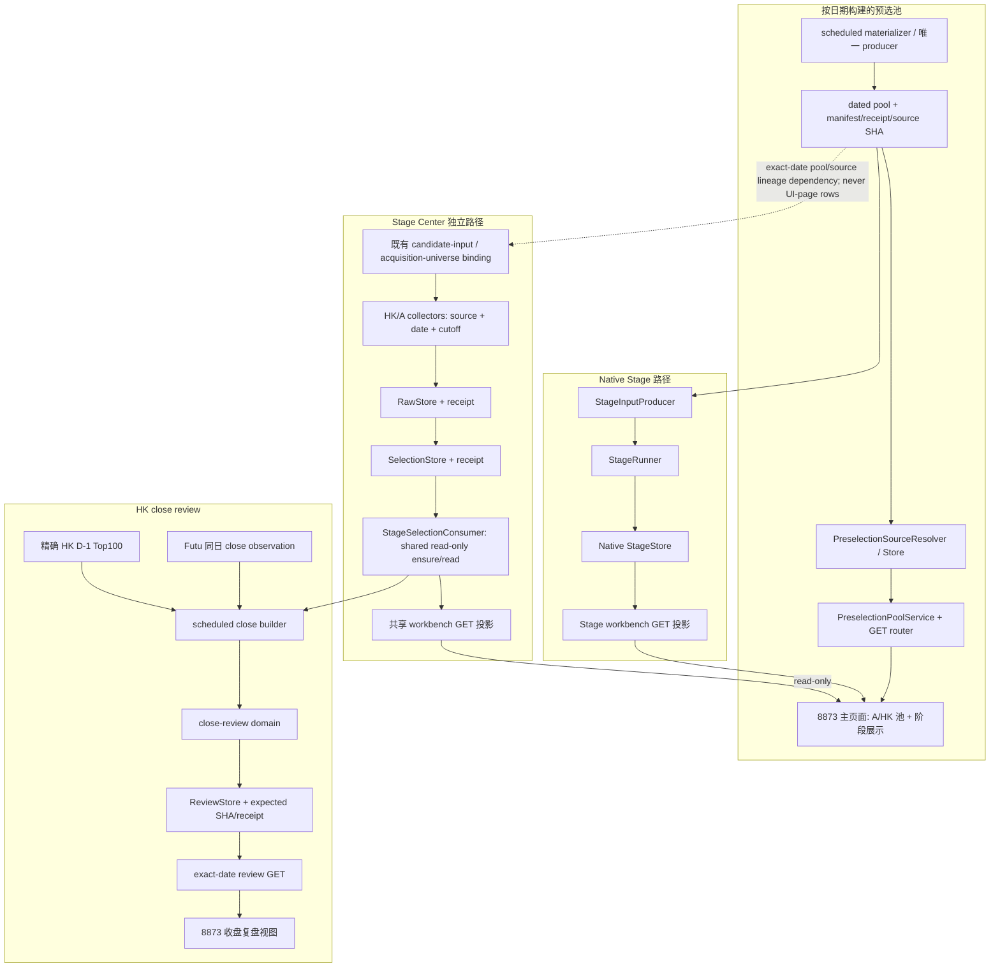

# 预选池 → 阶段选股 → 港股收盘复盘收敛设计

日期：2026-10-12　状态：方案提案（仅静态审计，没有实施业务变更）

## 目标

用最小、可逐批验证的改动使三个阶段的职责清楚，按目标日期、市场和来源身份传递数据，精简能被证实的冗余。修复用户已锁定的 A 股 partial pool 进入 Stage 的错位；把阶段展示与完整选择输入分开；保留 HK D-1 Top100/Futu 观察和 HK close 七阶段 formal union 的既有安全合同。全链通过唯一 8873 入口及其 API/产物合同接入，不新增 producer、面板或权威数据底板。

本轮只交付设计、计划、只读审计和机器账本。本轮业务测试 NOT_RUN；没有改业务源码/测试/配置/数据/release/服务或 Git。本设计不重新裁决用户 DECISION_LOCK，也不合并独立 manager-selection、A 股 FUPAN 内容、历史 prefix、人工生成或 Vibe 8910。

## 源码身份和当前路径

审计对象是 Git HEAD `55a5ba0b8aef8e83dfd04fdbabefb8d9baa1d054` 上的 canonical worktree 字节及有明确标签的 R1/R4 release 比较文件。runtime 证据不是源审计：API 在 13:55:37 UTC 观察为 `announcement-daily-chain-20261012-r4/app` PID 60020；14:09:45.534 UTC 又漂移至 `research-desk-20261012-r3/app` PID 66530，其源码和绑定未审。记录中的 Stage Center/Futu R4 scheduler 与 HK deadline 旧 R1 scheduler 均为 `NOT_RUNNING`；V3.5 scheduler 记录为 R1/PID 8009，但该进程的具体行为和最新 workload binding 未确认。HK close 计划任务的 R1 代码观察与实际自然任务行为分开处理。浏览器 bundle、preselection scheduler 的最终 source/owner 和实际绑定仍未由 API PID 推断。

R4 `ApprovedResearchReadBinding` 是旁路的精确 `20261009 / STAGE_0930_0935` 回放读取边界，非 Stage Center producer、非自然采集路线，也不提供分页 UI 行作为输入；其当前 backing pair/payload 仍为 `CANNOT_CONFIRM`。该固定日期边界不替代 `candidate-input / acquisition-universe binding` 的正式 source lineage。

Native StageStore 与 Stage Center RawStore、SelectionStore、runner receipt、latest pointer 互相独立。Native Stage 的 `/workbench/stage` GET/POST `ensure` 与 Stage Center 的 read-only consumer 不可按名称合并。API response 的 200 行上限只影响预选展示；stage producer 必须使用完整聚合输入，不得读取被分页/UI 截断的数组。

## 固定合同

| 数据/阶段 | 日期和身份 | 可接受状态及边界 |
|---|---|---|
| A 预选 | exact trade date；每条行可回溯到 pool producer、池名、source SHA/receipt；按单一 root 所有权读，不逐池拼 root、不回退 `latest` | 完整汇总 `a_all_pool_rows` 中任何有效且可追溯的 `market=A` 行都可进入 Native Stage 候选，包含 `a_share_baimao_research_map` 与 `wechat_public_account_v3_preselect` 中通过行级合同的 A 行；不得因 pool ID 白名单丢弃。missing/empty/partial sibling 只留 gap/evidence，不全局阻断；坏 pool 独立隔离。完整性不足不能被改写成零候选或 READY。 |
| HK 预选 | prior trading day 的 canonical `HK_CONNECT` D-1 Top100，固定 100 行、目标日、交易日历 split 与 source SHA | 不用其它日期、A 池、全市场或 latest 补位；失败明确 blocked/CANNOT_CONFIRM。 |
| Stage | 指定 `trade_date`、`stage_id`、market scope、时间窗、source lineage 与各 store receipt | 每个 stage 按其来源/截止合同走；显示行数不等于输入行数。Native 与 Stage Center 的 input/store/receipt/retry contracts 分开。Futu observation 不升格 PIT/formal。 |
| Close snapshot | 精确目标日 HK Connect close universe；现有至少 600 securities、100% coverage gate；行 SHA、manifest/receipt | 当前 active R1 cache payload 无 capture timestamp，文件日期不能证明采样时间。没有源 capture-time 证据不能确认 freshness，也不能升格 READY。 |
| HK close model/stage inputs | 精确目标日 canonical D-1 pool、exact-date close snapshot、精确 StageSelectionConsumer inputs | pool 确认缺少目标 artifact 可表示 missing；坏 manifest/receipt、parse/integrity error 保持 typed failure/CANNOT_CONFIRM，不能 catch-all 变空池。Stage ID 固定七个：`STAGE_0925`、`STAGE_0930_0935`、`STAGE_0935_0940`、`STAGE_0940_0945`、`STAGE_0945_1030`、`STAGE_1300_1315`、`STAGE_1445_1500`。 |
| Close union/partial | formal 输入必须 7/7 exact、verified；UI 导航仍可列八阶段 | 七阶段 union 缺一即不生成 formal union；`STAGE_1545_1555` 不在其中。partial observed 独立标 `PARTIAL_RESEARCH_ONLY`、`RESEARCH_ONLY=true`、`NO_BUY`、PIT 未验证及其它 safety false markers，不与 formal 合并。 |

`MISSING`、`READY`、`READY_EMPTY`、预选源的 `PARTIAL_WITH_ROWS`、Native Stage workbench 的 `PARTIAL_WITH_WATCH_ROWS`、`CANNOT_CONFIRM`、`OBSERVATION_UNVERIFIED`、`FORMAL` 是不同状态。缺少 rows 不足以在这几类之间相互推断。HK close metrics 中 `coverage`/`coverage_pct`、`precision`/`precision_pct` 和 `kpi` alias 是 API/前端兼容问题，须等消费者映射后，才可选定唯一 canonical 输出单位并删除兼容字段。

## 方案对比

1. **仅改 Stage A gate，保留版本与重复项。** 改动小，能修复 DECISION_LOCK 的直接错位；但 canonical 拆分与 API release monolith、active R1 close producer 与 R4 API contract 继续分化，难以确认之后该改哪一份。
2. **把各阶段合成一个 service/module/store。** 表面少文件，但会把 producer/consumer、Native StageStore/Stage Center stores、观察/formal 和不同 release owner 混在一起，扩大回归和运维半径。审计没有支持搬动大段 source 或合并 trust boundaries。
3. **合同先行，沿唯一 canonical source 收敛，局部精简（推荐）。** 先锁定版本 owner，再只改明确错位的 producer gate，另外独立处理 Stage Center 唯一的重复 factory 调用；close active producer 以替换式迁入 canonical，不双跑；版本/API/UI owner 对齐后再删重复类型、重复 metric alias 和 unused code。每批保持数据与安全合同可观察，失败回滚只限本批。

推荐方案不会追求最少文件数；职责清楚和错误可诊断是精简的验收条件。诸如 optional pool merge 的删除仍需关闭 CLI/config/reflection/import 消费者图后才能进行。

## 变化建议

- 在 `domains/stage_input_producer.py::StageInputProducer.produce` / `_stage_candidates` 取消 `eligible_ids` 对完整 A 汇总的 pool-ID 黑名单，按现有 `a_all_pool_rows` 投影语义纳入每个已验证 pool 中 `market=A` 的有效可追溯行；HK 仍仅从精确 `hkconnect_d1_top100` 来。坏 pool 单独 quarantine，missing/empty/partial/status/source gaps 仍写入证据。Stage readiness 不能因为还有有效 A 行而越过 `CANNOT_CONFIRM`。
- `PreselectionPoolStore.read_all` 目前只跳过 missing artifact，遇到单 pool manifest/receipt integrity `ValueError` 会中止。未来的 per-pool API 在同一 exact root `.import.lock` lease 下逐池复用 `read_pool_snapshot(trade_date, pool_id, *, lock_lease=lease)` 的物理快照校验；仅明确能归属该 pool 的 artifact/manifest/receipt/row-integrity typed error 可被隔离。root owner 变化、锁/preflight、pending-commit、路径安全和未分类 I/O 错误继续 fail closed；不改变现有 `read_all` 调用语义、不逐池解锁后拼快照、不跨 root 拼池。
- 保留 pool store exact-date、root owner 和完整 manifest/receipt/SHA；PreselectionPoolService 和 HTTP router 只读，分页只服务 UI。Stage API 不从 UI response 重建输入。
- Stage Center `slot_execution` 只删除无配置 builder 分支中先创建随后丢弃的第一次 factory 调用。不要触碰 HK D-1/source SHA、两段 store 发布、receipt/latest 或 partial-commit recovery；保留 `tests/test_hk_stage8_v4_recovery.py::test_same_day_route_is_natural_and_historical_route_is_not`，确保 `STAGE_1545_1555` 同日自然 Futu 路径仍为 natural、历史 replay 路径仍不得冒充 natural。Stage8 仍在七阶段 close formal union 之外。
- close producer 把活跃 R1 collector 的逻辑迁移至唯一 canonical source，前置确认 capture timestamp 可追溯和同日 cache reuse/cutoff 规则；一旦 canonical 版本通过，scheduler owner 再将现有任务指向它。拒绝 R1 与 canonical 同期双 producer。
- canonical close builder 只把精确缺少 `hkconnect_d1_top100` 的 sentinel 变成 missing；manifest、receipt、类型和完整性错误保留为失败。close domain 输出保留 pool/source/manifest/receipt identity、seven-stage evidence 和安全旗标；ReviewStore 持续用 expected prior SHA supersession。
- ReviewStore validator 按 schema 分支要求安全标记：当前 native `v3_5.close_review.v1` 要有 `RESEARCH_ONLY=true`，formal/partial 结构分开；既有 imported `v3_5.close_review_reference.v1` 继续依赖 `reference_snapshot=true` 和原有只读 safety flags，不因缺 native marker 失效，也不升级为 native formal。所有未知输入仍 `CANNOT_CONFIRM`。
- UI 由 `useAppShell` 管日期切换、abort/version、loading/error/selected state；一个 API boundary 负责 pool/stage 请求、wire date/stage/market/pagination validation；`api/review.ts` 继续持有 exact-date review GET 和显式 manual generate POST。实际 bundle 与 source owner 对齐前不迁移 R4 2456 行单文件实现或删除历史日期绑定特例。

## 精简候选和条件

- `stage_center/_runner_parts/slot_execution.py:256-267` 的第一次 factory 结果被下一赋值覆盖，静态上未消费。只有 call-count regression 和已存 lane/recovery tests 通过才做。
- `useAppShell.ts:127-141,293-296,416-418` 有限派生量、`app_shell/types.ts:120-123` 的未用 DTO 是有限删除候选；`contracts/review.ts` 与 review-only types 合并前须检查 optionality/字段合同。
- `domains/close_review.py:43-73` metric alias 需要先列出所有 API/UI consumer 与序列化兼容窗口。
- `domains/_preselection_parts/optional_pool_merge.py` 是唯一小范围删除候选，但还需查 CLI/config/reflection 动态 consumer；本轮先不删。

不能删除 source provenance、store receipt/supersession、日期/root owner、error mapping、cutoff/retry、prepublish validation、partial commit recovery、formal/observed separator 来换代码行数。R4 `ApprovedResearchReadBinding` 是特定日期和 stage 的只读回放器，不能当 producer、自然验证或默认 API；它的 exact pair/backing payload 尚 CANNOT_CONFIRM。

## 验收

行为验收要有独立 Reviewer 用固定输入验证：同步更新旧反向测试 `tests/test_stage_input_producer.py::test_native_producer_reads_independent_graph_pools_and_excludes_research_only_lanes`（fixture `:136-150`）以证明 Baimao/WeChat 中有效 `market=A` 行进入完整汇总；missing/empty/partial sibling 场景仍选到有效行、单个损坏 pool 被隔离、root/lock 错误 fail closed、来源缺口保留。验收必须走 `StageRunner.ensure` 后读 `read_workbench` 的真实结果：新增/延伸 `tests/test_stage_input_producer.py::test_stage_runner_workbench_keeps_partial_a_as_watch_only`，确认有效 A row 实际出现且 `recommendation_status=WATCH_ONLY`，Stage workbench `stage.status=PARTIAL_WITH_WATCH_ROWS`、`markets.A.source_status=CANNOT_CONFIRM`、partial evidence 保留、不得 READY；只验证 producer candidate/input 不算通过。HK pool/date/source SHA 未变化。Stage Center 仅 factory 调用次数下降，保留 `tests/test_hk_stage8_v4_recovery.py::test_same_day_route_is_natural_and_historical_route_is_not`，证明 Stage8 同日 Futu 自然路径与历史 replay 路径仍分开，其他事务/recovery receipt 不变。Close exact-missing 与 corrupt inputs 区别明确、7/7 才 formal、partial 仍 research-only；native schema 新增 `RESEARCH_ONLY` 验证不得阻断没有该字段的既存 `v3_5.close_review_reference.v1` imported blocked reference，expected-SHA supersession 仍成功。最终 API、preselection scheduler、Stage scheduler 和浏览器 bundle 分别对齐，再做目标日 API/UI readback；自然时段验证另行记录。任何一层缺证据写 CANNOT_CONFIRM，文档或 focused tests 不能代替。
