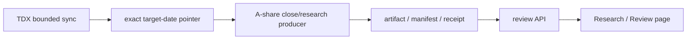
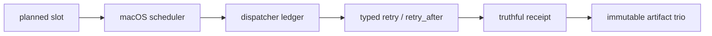
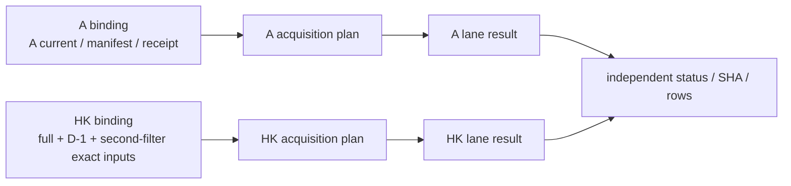
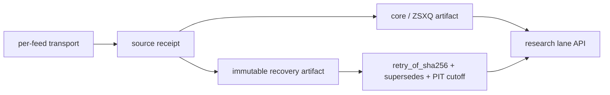
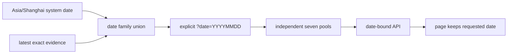

# V3.5 runtime / selection / research graph

This document describes the static topology contract in
[`contracts/v35_runtime_graph_topology.json`](../contracts/v35_runtime_graph_topology.json).
The contract is generated from the V3.5 workload catalog and the two timeline
arrays in `apps/web/src/App.vue`; it is not a second hand-maintained scheduler.

## Evidence boundary

The old V3 timeline is a design-only migration baseline. Its SHA is frozen in
the contract and is used only to explain semantic ancestry. It is not a V3.5
runtime result, data source, release, or page fallback. The live release,
launchd/plist, process, state root, artifact trio, API, and page must be
verified independently by the separate live-binding snapshot seam. Until that
snapshot is collected, the live binding status is `CANNOT_CONFIRM`.

Every node carries the research-only boundary:

```text
production_allowed = false
buy_gate_updated    = false
orders_sent         = false
```

## Generated end-to-end topology

The current merged V3.5 source inputs produce 19 timeline chains, 247 nodes,
and 323 edges. The deterministic contract semantic SHA for this build is
`a5afbdcecc98346610fe43e2ad7ce77de97e80e1c61dd15f213b5a025ec544b2`.
The frozen design-only V3 baseline remains
`c0cf5f917665473cfb22476f10b120399f79e8a43746e0ef06792c68b7baa1fe`.

```mermaid
flowchart LR
  old["old V3 semantic baseline\ndesign-only / read-only"]
  launch["launchd launcher\nimmutable release + plist"]
  workload["typed workload / planned slot"]
  dispatch["dispatcher\nLIVE or BACKFILL"]
  execute["executor registry"]
  produce["date-bound producer"]
  store["authoritative store"]
  trio["artifact + manifest + receipt\nSHA and source evidence"]
  current["current / latest\nCAS pointers"]
  api["read-only API route\nexplicit date"]
  page["App / Research / Review\npage consumer"]
  safety["RESEARCH_ONLY\nno BUY / no orders"]

  old -->|migrated_from| workload
  launch -->|schedules| workload
  workload -->|invokes| dispatch
  dispatch -->|invokes| execute
  execute -->|invokes| produce
  produce -->|writes| store
  produce -->|writes| trio
  store -->|validates| trio
  trio -->|writes| current
  current -->|projects| api
  api -->|renders| page
  api -->|binds| safety
  page -->|binds| safety
```



There are exactly 19 generated timeline chains. Each chain repeats the same
auditable spine while deriving its workload ID and planned slot from the
contracts and App source. The two current pointers are represented separately
so a stale `latest` cannot silently stand in for a verified `current`.
The first eight chains are the stage timeline parsed from `stageDefinitions`;
the final eleven are the closing/research timeline parsed from the
`closingTimeline` source array in the merged `App.vue`.

## Five recurring failure chains

### 1. A-share exact-date readiness



An old snapshot or a zero exit code is not a passing edge. If the exact-date
pointer or its continuity check is absent, the chain remains
`CANNOT_CONFIRM` and the receipt remains retryable.

### 2. Scheduler catch-up and truthful receipts



`LIVE` and explicit historical `BACKFILL` are separate modes. A retryable
failure is not converted to a successful `ALREADY_ATTEMPTED` result.

### 3. Stage Center A/HK lane isolation



One missing A current must not prevent a valid HK lane from collecting and
publishing. The combined status may be `PARTIAL_WITH_ROWS`, but each market
keeps its own evidence and failure reason.

### 4. Hourly research recovery



Successful sources are not rerun merely because another peripheral source
failed. A same-slot recovery must retain its parent SHA and source receipts;
otherwise it is a conflicting input, not a replacement.

### 5. Date, pool, and page semantics



`system_date` is the wall-clock natural day; `default_date` is the latest
verified evidence day. A partial target-date pool family is still listed and
the absent pools remain individually `CANNOT_CONFIRM`; no date silently falls
back to an older evidence day.

## Static versus live

The JSON contract is deterministic and suitable for code review. A future
deployment may overlay a live snapshot containing the actual release ID,
plist, interpreter, workdir, process, state roots, and artifact SHA values.
This batch deliberately creates no such snapshot and performs no deployment or
backfill.
