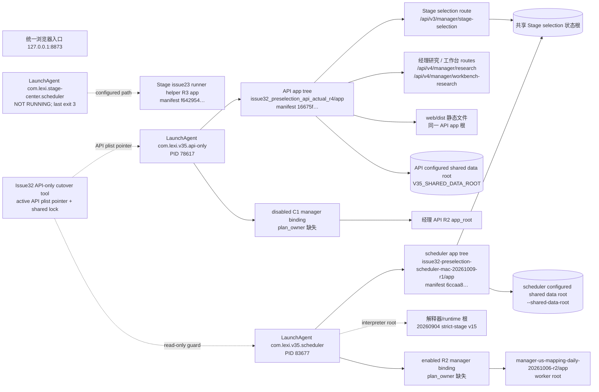

# Stage / 经理当前运行与发布依赖图

本图只描述 2026-10-09 14:33 +08 的读取结果，不表示期望架构或证明模块隔离。证据：`manager_evidence/current_runtime_identity.json`、`manager_evidence/SHARED_SURFACE_20261009.md`、`STAGE_SHARED_BOUNDARY_20261009.md` 及 Issue32 API-only tool 源码摘录。

## 如何解释

- 实际 8873 API app 在一个进程/应用根里注册 Stage route、两个经理 router，并从相同 app 根挂静态页面。API 根发布会改变这三块同包字节，因此目前不是模块级 API 发布。图只把 Stage route 连到 Stage state；没有证据支持 manager research/workbench router 直接读写该 state。
- scheduler 是独立 LaunchAgent 和源码树，且使用不同 manifest；其 Python runtime 来自更早 release。不要把 runtime venv 根、API app 根、scheduler app 根或 API tree 内的 scheduler 源码副本相互替代。
- 经理运行有两份 binding：API 读 disabled C1；scheduler 读 enabled R2。两个 binding SHA 不同，均没有 `plan_owner`。进程运行状态不能证明已完成经理计划执行。
- API 与 scheduler 均指向完全相同的 Stage selection state 根。API 的 `V35_SHARED_DATA_ROOT` 和 scheduler 的 `--shared-data-root` 是不同路径（分别位于 v4.local 与 v35.local），本图不把它们折成同一数据根；源码根分离不能说明任一 state/data owner 已独立。
- Stage scheduler 当前未运行；它与经理候选共享发布边界的具体覆盖因果 `CANNOT_CONFIRM`。R3 shared root release 和 Stage delta 均 `NOT_RUN`。
- API-only tool 的代码目标是切换整个 API app 根，同时将 scheduler 与 binding 留在只读 guard 内；“API-only”不是 manager-only，也不等于已支持 Stage/经理双服务切换。
- 当前 8873 静态 UI 实际加载内容未核。Stage receipt 中 `App.vue`、`runtime.ts` 有现存修改且历史前像不匹配；静态 UI 的独立平台 owner 尚须 architect 正式合同确认。

