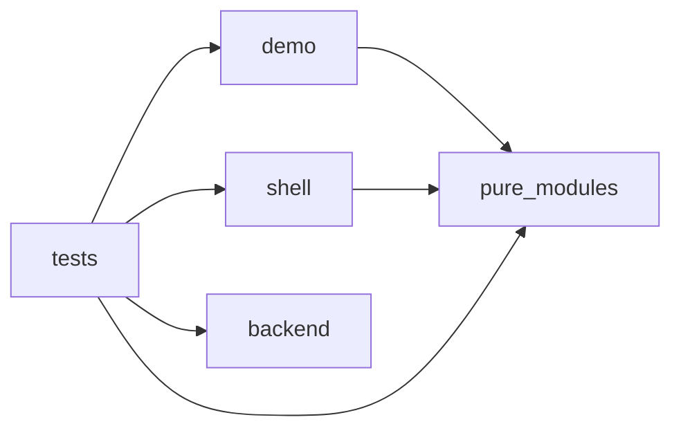

# Public framework code map

Static syntax evidence, not runtime or test PASS. Source commit is not yet assigned; exact source bytes are pinned below. Known base: `34c353cc1ba4ae0d02fbf36bc6158f38ff17fe10`.

Status: **VISUAL_QA_BLOCKED_NOT_DEPLOYED**. The code links are relative to this documentation directory (`docs/code-map`) and resolve to source in the same eventual commit, not to the older base.

Source digest: `c7dee556d534a2c557193cf3065cf80c462b771d106683e5faa9d1bfff6dceb3`

|File|SHA256|Lines|
|---|---|---:|
|[demo/demo.mjs](../../demo/demo.mjs#L1)|`75c0d0186e7a9798be8fc68e480137502a640a9a9c9bb6c3a92f000f72337e27`|2|
|[demo/index.html](../../demo/index.html#L1)|`e9cc45993dbca7e4d44f48b7deb13326cad8eb1fe9759fbd1c1843f2dda3bafa`|2|
|[demo/synthetic.mjs](../../demo/synthetic.mjs#L1)|`a52154ee80ea7ba54cbfdbc6a3ff5925454f15ef4ff081c219021314e98b4796`|5|
|[schemas/OBSERVATION_SCHEMA.sql](../../schemas/OBSERVATION_SCHEMA.sql#L1)|`1099b588ad471e2bcfbcf6e785de13665164585cda1d54be421e20d34fa652ca`|17|
|[shell/company.mjs](../../shell/company.mjs#L1)|`94c6f0ba5b5f30ece93b89a5bc78201cf1d0ec6fe564f2ed54e8aaa0ac27c529`|5|
|[shell/index.html](../../shell/index.html#L1)|`787006345ab1e1c736570dec51bb5a3681a48b57d3e0e106773578abc6096fd8`|6|
|[shell/market-archive.mjs](../../shell/market-archive.mjs#L1)|`d305c7868ef7a032e50fa7d09118ce121ad6d51c031232ba0c19ccb3ed1bbbeb`|5|
|[shell/research-system.html](../../shell/research-system.html#L1)|`787006345ab1e1c736570dec51bb5a3681a48b57d3e0e106773578abc6096fd8`|6|
|[shell/workbench-context.mjs](../../shell/workbench-context.mjs#L1)|`c013f17facdf86e093d5291e941249ad6de32c2eb44fa55b0b82c49f8615d2d3`|30|
|[shell/workbench.mjs](../../shell/workbench.mjs#L1)|`65044857a2eb6a84db24dda6179f87b81613ee050bdf2d29b0d3337e726e9179`|50|
|[shell/workflow-materials.mjs](../../shell/workflow-materials.mjs#L1)|`1cd0a2f3c2052e431fcc3ce6cb198d74380bb9a9c71014ac994dc8bfca4ab814`|13|
|[src/backend/bounded-bytes.mjs](../../src/backend/bounded-bytes.mjs#L1)|`dc8ff8afe62e0b700765156734e9176e7ad0eadb66478c55a643755bbcf74744`|32|
|[src/backend/bounded-json.mjs](../../src/backend/bounded-json.mjs#L1)|`922fafe8e7015a3870f4148d8e852989dcb45fd57ec2f238537975660a0b3ef4`|10|
|[src/backend/contracts.mjs](../../src/backend/contracts.mjs#L1)|`cdb5ea9f8970705d504edf4aff0a9c0ab740d8b4cda64153128336f9c42c0dc4`|8|
|[src/backend/observation-volume.mjs](../../src/backend/observation-volume.mjs#L1)|`89a8dbbf5dc4fd9794924a485ef6d0a8b62bcefa0f22dc964f09116ed6d4b504`|11|
|[src/backend/observations.mjs](../../src/backend/observations.mjs#L1)|`aba75fdf5c9579bf825c93920b38e5d325ffa1abcb96907f6143d79f66906cd1`|27|
|[src/backend/trusted-bindings.mjs](../../src/backend/trusted-bindings.mjs#L1)|`25312ce10c85777c356bfe62b46139dde27382f76bf426759955f46a6b0b8924`|3|
|[src/model.mjs](../../src/model.mjs#L1)|`1825e8bde206bca16b219a265648ce4b8791d00d69e64e9737002ead26e2d42b`|7|
|[src/observation-view.mjs](../../src/observation-view.mjs#L1)|`c7ba4f79acef6bf549946ce1cc12d3a4ea19d380b46aa973e943564d892e6ecc`|32|
|[src/projection-view.mjs](../../src/projection-view.mjs#L1)|`a31daea95ae7ed4f4312e882eaafbefbe733837d96c0a81e561e6b70bb25a8b7`|22|
|[src/readonly-adapter.mjs](../../src/readonly-adapter.mjs#L1)|`574fb8e41a68b356180337ad38886c692595d4d653c95ade0c35bc974c62eb1e`|3|
|[src/upload-pool.mjs](../../src/upload-pool.mjs#L1)|`f15907ac909770771106cac2612ca3bf084798975c962e907f2fcdda0af562f2`|10|
|[src/workbench-model.mjs](../../src/workbench-model.mjs#L1)|`6c0dea1c7dacf8243fc943cd28ff2ec3b98729fc3fb2f1c696d9066919534886`|7|
|[src/workflow-time.mjs](../../src/workflow-time.mjs#L1)|`a2b65eec48872122a1b1f67008b9f368a4fb46e069380add3eb662f42f761a38`|6|
|[tests/backend-reference.test.mjs](../../tests/backend-reference.test.mjs#L1)|`30fe2444ff348ee4a7fc0368a22877b3cf2f99c000cec03d3f0fa5547f4040eb`|8|
|[tests/framework.test.mjs](../../tests/framework.test.mjs#L1)|`c65eec95eb1f07ab84b7ad621b632424690da5086192cdf3cf5d5ac19e361f28`|7|
|[tests/market-archive.test.mjs](../../tests/market-archive.test.mjs#L1)|`20de6b5190e4e3593823bb60582d460d212dd85349554faa22ee0deda7147abf`|6|
|[tests/observation-view.test.mjs](../../tests/observation-view.test.mjs#L1)|`205b0694e0115a2a33d4a1861c991ba01ae3d5b01b41c28262a2a6ef50922b37`|14|
|[tests/shell.test.mjs](../../tests/shell.test.mjs#L1)|`f1e8101831d76f0e29f0814325b237e42de453a87caab2211dbc9d6c526df7eb`|4|
|[tests/workbench-date.test.mjs](../../tests/workbench-date.test.mjs#L1)|`f271dd949ed6fcf3dea8fc63df706221ae605b5234136e219750bfee78f70631`|14|

Exact edges/unknowns: graph.json. Reverse static dependency examples: impact_examples.json. No private source data, deployed runtime, original chart renderer or personal SOP is included.

## Module imports (derived from the indexed static edges)

Arrows are imports only, not actual requests or test execution. For complete individual-file edges and explicit unresolved expressions, read graph.json.
