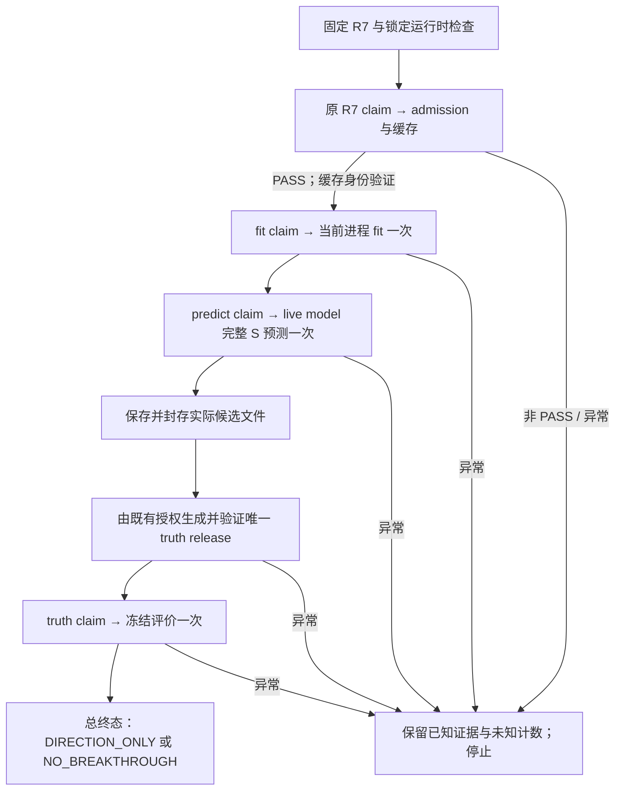

# BREADTH1 R7：同进程一次性修复与本地运行手册

日期：2026-10-11。范围：F5 daily exactly Top3 / 原始 NEW label / PLUS64 + BREADTH1。交付状态：**代码与控制文件候选已完成，84 项针对性离线测试通过；真实运行尚未执行。**

当前下一步是：本地操作者用既有锁定解释器完成本包的离线检查，核对原登记簿中 R7 与模型动作未消费，应用固定文件集合，再运行本手册唯一的同进程入口。无需补 producer 历史材料，也不产生新的 recovery/grant/execution ID。

## FINDINGS

### 1. 本次依据与证据层级

本次以用户提供的 `CHAT_FIX_HANDOFF_20261011.zip` 中当前 R7 为唯一 before 基线，已核对 ZIP CRC、路径唯一性及 manifest 的 58 项 bytes/SHA。原 ZIP SHA256 为 `fed43db93ac6a638e1e7870848e1c58015e42d0010a8ef09915483554d39836f`。原交接材料的完整小型副本保存在 `source_evidence/CHAT_FIX_HANDOFF_20261011/`，不含真实原始数据、模型、候选分数、完整真值或真实登记簿。

较新的 R7 `STATIC PASS` 是父级转述，不是签名审阅回执；较早的 `R7_STATIC_PREPARATION_VALIDATION_RECEIPT.json` 仍为 `PENDING`。二者都作为历史证据保留，没有被本次改写成运行 PASS。本包新增的 `PASS_OFFLINE_ONLY` 明确只对应修复后的离线验证。

### 2. 当前代码已经正确的部分

| 检查对象 | 本次结论 |
|---|---|
| R4 的 `list.map` 历史错误 | 当前 `_attach_parent_market_date` 已使用列表推导；没有把旧错误当成 R7 新复现。 |
| R5 的 binding identity 历史错误 | 当前 read release 已核对实际 pending binding 路径与 SHA，调用方传递当前 R7 路径。 |
| R6 的 helper NameError | helper 已定义，并在两处调用前局部导入；本包的生产模块全局名称检查为 0 unresolved globals。 |
| float64 原始二元标签 | 当前 admission guard 已接受精确 `i/u/f` 二元标签，并继续检查 shape、有限性和 899 个正例。没有改标签定义或内容。 |
| 日历映射 | 当前已有 session→date 映射、重复/缺失键和覆盖验证、行序保持；本次补严非法日期与 CSV 先强转类型的问题。 |
| 评价报告 | 当前 evaluator 已包含 S 域排名、不可评分 G 单列、替换项、季度/半年及门槛状态逻辑；保持该模块原字节。 |
| 预算 | 原 action adapter 仍在官方锁内于 RUN_STARTED 扣减，固定 action key/cap 不变；新入口复用该边界。 |

R4 输入恢复失败的实际读取量仍 `CANNOT_CONFIRM`；R5 的退出位置、R6 的两份控制文档/39,673 字节和零冻结目标读取，仍只归属于相应历史回执。本次未重建或补填历史计数。ABC 的 R4 三臂失败并关闭这一结论也未改变。

### 3. 当前确实存在并已修复的缺陷

| 缺陷 | 实际修复与意义 |
|---|---|
| CLI 无完整真实入口 | 原 `main()` 无条件阻止真实执行。新增 `--registered-real-chain`，从检查、准入缓存一直执行到封存与评价，不在 admission 后退出。 |
| 缓存仍绑定 pre-admission SHA | PASS 后验证 old binding → admission receipt → final binding → verified arrays 的一致关系，只更新缓存 receipt 身份；所有数组、frame、mask、calendar 对象继续复用。 |
| 子进程 fit 后重新加载模型 | worker 改为当前进程执行一次 `lgb.train`，直接将 live model 交给一次完整 S 预测；保存模型用于审计，不使用 `Booster(model_file=...)` 重载。 |
| worker 对标签做不必要的 int32 转换 | 将已验证的原 float64 标签对象直接交给 Dataset，保持数值、dtype 与对象。原来转换没有证明标签损坏。 |
| CSV 标记/键在校验前窄化 | 取消读取时的 int8/int64 强制窄化，使非法 257/256、布尔值、非整数等先经过严格检查，防止先变成合法 0/1。 |
| 日历只检查非空和唯一、未拒绝不存在日期 | 补充真实日期解析验证；保持原日历、映射、范围与行序，不生成新日历。 |
| 读取失败漏计或把未知写成 0 | 完整 payload 即使 SHA 错误也计入实际已读 bytes；reader 中途异常时，无法确认的文件数/总字节为 null，同时保留已知 bytes、完成次数和尝试次数。 |
| admission 的后续异常丢失已有 receipt | 将不含缓存的审计快照附在异常上，外层保留原 receipt path/SHA 与已观察读取量；不靠重读恢复。 |
| terminal 追加后读回报错又尝试写 terminal | 写前设置 `terminal_attempted`，同一 claim 只尝试一次终态；后续错误作为 note 保留，不掩盖原错误。 |
| truth 终态缺失时被写成调用 0 次 | 阶段 receipt 与总 receipt 共用已验证的 action observation；缺终态、错 SHA/ID 或登记簿不可读时，未知调用数/额度为 null。 |
| 评价错误被登记读取错误或多层包装遮蔽 | 两层 receipt 保留首个异常的 type/message/notes，以及最多 8 层 cause/context 链。 |

CSV/日期错误由生成的小样例复现，不能据此声称冻结目标文件已经存在这些错误。当前合同与实现使用 gzip CSV；本次没有新增 Parquet 读取分支，也未声称验证了不存在的 Parquet 路径。

### 4. 科学定义与资源政策

唯一新增科学变量仍为：同日完整原母池中，已存储 `ret_1d` 有限且大于 0 的行数，除以已存储 `ret_1d` 有限的行数。NaN 保留、排除分母并按日计数；不推断 NaN 原因、不填补、不重算收益。

原 64 列顺序/类型/位值/掩码、539,631 行训练集、899 个正标签、原始 NEW label、PLUS_PATH 与 BASE34 对照、246 日 × 3 席位、成本、固定评价器和门槛都保留。candidate 对 PLUS_PATH 的 paired lower bound 仍需 `> 0`，对 BASE34 仍需 `>= 0.03`。`FROZEN_BCE_PARAMS` 和 `FROZEN_ROUNDS` 的 AST literal 一致，core、budget、evaluate、`__init__` 四文件逐字节不变。

输入来源继续为 `FROZEN_INPUT_AS_OBSERVED_RESEARCH`，历史 producer 状态为 `LINEAGE_UNAVAILABLE`。scope 中旧的“lineage unavailable 即停止”文字已改为当前接受的来源政策；没有伪造 producer PASS。

资源使用沿用当前 R7 已接受政策：全部可用逻辑 CPU；RSS/wall 只观测、不设新硬限额。保留冻结参数字典中的原值和既有运行时线程覆盖。资源 trace 标识 `SAME_PROCESS_LIVE_MODEL`，RSS 包含当前进程缓存输入；不再伪称独立训练子进程退出码。旧 CPU4/3GiB/600 秒政策没有恢复。

## PATCH

### 1. 交付内容与精确落点

| 路径（相对本包） | 用途 |
|---|---|
| `patches/BREADTH1_R7_ONE_PROCESS_FIX.diff` | 可应用 unified diff；9 个实际改动文件。 |
| `before/` | 原 R7 七模块、五个活动 JSON 和 scope，共 13 个安装核对文件。 |
| `after/` | 完整七模块和更新后的 R7 控制文件；可逐文件审阅。 |
| `R7_INSTALL_MANIFEST.json` | 13 个固定项目相对落点的完整 before/after SHA256、bytes；9 改动、4 不变。 |
| `tools/apply_r7_candidate.py` | 原官方锁下的 check/apply/rollback；不 claim、不追加登记事件、不改运行收据。 |
| `tools/run_offline_validation.py` | 本包限定的 84 项测试和静态检查入口。 |
| `tools/check_r7_static.py` | 纯 stdlib 编译、AST、symtable、生产模块依赖及冻结源码检查。 |
| `tools/rebind_r7_candidate.py` | 生成/核验同一 R7 的候选 SHA 链；交付时已生成，无需重新生成后再执行。 |
| `tests/`、`reviews/`、`evidence/` | 针对性测试、独立复查、基线失败与修复后通过记录。 |

源码落点固定为 `/Users/lexi/Desktop/学习/因子工厂/workspace/f5_breadth1_r3_frozen_input_20261011/src/`，只改变 inputs、worker、runner 三模块。控制文件落点固定为该项目下的 `research/hk_burst_f5/batches/breadth1_r3_frozen_input_20261011/`。五份 JSON 只更新必要 SHA 字段；所有非 SHA 字段与原件一致。

三个源码文件的完整身份：

| 文件 | before SHA256 | after SHA256 |
|---|---|---|
| `f5_breadth1_inputs.py` | `80ecf40580b05fc998acd986dc430a4b3aa11e3763467c61614aba9ddaf3bc55` | `2c680ff41e616a813007e60efe9dff02a2baba83b5de48b280a6000e1449d424` |
| `f5_breadth1_worker.py` | `a439703f948f2ff56a87b94cbb9e580912167c258e7af4277980884c94256bf1` | `08b20a81d40bd25e24fa6ed282c08fceed31396ad619d3cb8189ef20a366edca` |
| `run_f5_breadth1.py` | `a98cb896208c89753ef805cb537a346e0a91043f01b61972b851c0f16158be6b` | `166b993c0b1582718a005e1f2a90fdf1622bd8e8ac1a2e770ff38cdfd4394dd9` |

补丁 SHA256：`39d278bf8be192a6d2b93e9297a94d1fd84b3f887929f659acc6651ddbea92b5`。

安装清单 SHA256：`2da8b1a8c6ef697af6e538dc6e54b8269e13030dda72f014dac57782f2711bf8`。

### 2. 固定身份和封存后的 release

- grant ID：`PARENT_PANEL_DATE_RECOVERY_R7_ENGINEERING_RETRY_20261011`。
- admission execution ID：`F5_PLUS64_BREADTH1_R3_FROZEN_INPUT_20261011_PARENT_PANEL_DATE_RECOVERY_R7_ENGINEERING_RETRY_20261011_ONE_SHOT`。
- admission action key：`F5_PLUS64_BREADTH1_R3_FROZEN_INPUT_20261011:F5_PLUS64_BREADTH1_R3_FROZEN_INPUT_20261011:input_admission_recovery:PARENT_PANEL_DATE_RECOVERY_R7_ENGINEERING_RETRY_20261011`。
- fit/predict/truth_decode 沿用原 route/candidate 的各自固定 key、execution ID 与 cap=1；不变更已消费 R3–R6 历史。

SHA 依赖按源码 → contract → pending binding → read release → read plan → grant 重绑。五份活动 JSON 的非 SHA 字段保持原件；contract 仍 `DRAFT_NO_REAL_RUN`、pending binding 仍 `ADMISSION_PENDING`，没有预先制造准入 PASS。

运行时的 FIT/PREDICT release 只在官方 adapter 验证真实准入 PASS、实际 admission receipt 与登记生命周期后，依据原 R7 的 conditional continuation 生成。truth release 要等实际候选文件封存后生成，精确绑定 seal、handoff、三份候选 artifact 的 path/SHA/bytes，以及实际 fit/predict terminal SHA。release 里的 `authorization_basis` 指向既有 grant 与其用户授权；没有新授权或补充预算。

新增的 candidate identity/provenance 在交接包 `after/.../receipts/` 中供审阅，状态为未执行候选；安装器不将它们当作真实运行收据写进项目。

### 3. 实现调用图



主入口为 `run_registered_real_chain()`。输入缓存转换函数为 `_rebind_cached_prepared_inputs()`；release 生成/校验为 `_write_chain_action_release()`；已有 `run_real_candidate_pipeline()` 和 `resume_sealed_evaluation()` 在同一调用栈内连续执行。中途的 `AWAITING_TRUTH_RELEASE` 是持久化封存检查点，主入口不会在这里退出。

## VALIDATION

### 1. 本次实际执行的结果

最终统一验证在云端 Python **3.12.14**、numpy **2.3.5**、pandas **2.2.3** 上进行；没有安装包，没有导入 native LightGBM，没有访问真实输入或官方登记簿。

| 检查 | 结果 |
|---|---|
| 全部针对性测试 | **84 项，0 failures，0 errors，0 skipped**。 |
| 7 模块编译/AST/symtable | 全部通过，0 unresolved globals。 |
| 生产模块相互 import/member | 24 处通过。 |
| 冻结模块逐字节比较 | `__init__`、budget、core、evaluate，4/4 不变。 |
| 冻结 BCE 参数与轮数 | AST literal 一致。 |
| 固定评价器及其依赖 | 7/7 与原 manifest 和 core 中 SHA 一致。 |
| 原 R7 控制文件非 SHA 字段 | 全部一致；51-field grant 保留。 |
| unified diff | 隔离副本内正向 check/apply、反向 check/apply 全部成功，13 文件逐字节比较通过。 |
| 禁止真实边界的测试审计钩子 | 0 次触碰被禁边界的尝试；native LightGBM、实际输入路径、实际登记簿均未访问。 |

84 项由：输入/日期 20、worker 7、缓存/入口 5、主链 13、准入异常收据 5、release/额度观察 11、R7 重绑 7、安装/回滚 15、静态工具正负例 1 组成。最后一项测试方法包含正例、真实缺失全局名称负例和合法局部导入不误报检查。

主链测试实际穿过入口、缓存转换、封存、release、resume 与总 receipt；外部的真实 registry、数据准入、native model 和 truth metric 边界使用明确 fake。它们验证程序如何接续和停止，不构成真实样本指标验证。

两处历史 `f5_breadth1_synthetic_fixtures` 局部导入位于旧 `run_test_only_fake_worker_seal_eval_chain` / `run_synthetic_io_chain`；其文件不在本次冻结七模块与小包中。静态结果逐条标记 `NOT_IN_REAL_CHAIN_AND_NOT_VALIDATED`，没有将其算作生产导入通过，也没有伪造该 helper。当前真实 CLI 不进入这两个旧函数。

权威最终收据：`evidence/final_offline/OFFLINE_VALIDATION_RECEIPT.json`；完整日志：同目录 `TARGETED_TESTS.log`；静态结果：`STATIC_CHECK.json`；控制身份：`CONTROL_IDENTITY_CHECK.json`；补丁往返结果：`evidence/PATCH_ROUNDTRIP_RECEIPT.json`。早期红灯和中间候选审阅保留各自 SHA，最终候选以最终 aggregate receipt 中七模块 SHA 为准。

### 2. 本地限定验证命令

将完整 ZIP 解压为项目外的目录，例如 `/Users/lexi/Downloads/BREADTH1_R7_ONE_PROCESS_FIX_20261011`。本包是目录完整的可搬移交接，不需要重新搜索源材料。以下变量只是命令简写，不改变解释器或项目身份：

```bash
R7_FIX_BUNDLE="/Users/lexi/Downloads/BREADTH1_R7_ONE_PROCESS_FIX_20261011"
R7_PROJECT_ROOT="/Users/lexi/Desktop/学习/因子工厂"
R7_LOCKED_PY="/Users/lexi/Documents/Codex/2026-09-12/referenced-chatgpt-conversation-this-is-an/work/hk_spike_f5_v1/HK_SPIKE_F5_TRAIN_V1/.venv_locked/bin/python3.13"
```

只运行本包的离线测试与静态核对：

```bash
"$R7_LOCKED_PY" -I -B "$R7_FIX_BUNDLE/tools/run_offline_validation.py" \
  --bundle-root "$R7_FIX_BUNDLE" \
  --output-dir "$R7_FIX_BUNDLE/local_offline_validation"
```

预期 exit 0，`status=PASS_OFFLINE_ONLY`、`tests_run=84`、failures/errors/skipped 全 0。输出目录必须是新的；本命令只用生成样例和包内源码/控制材料，不调用真实入口、不消费额度。它会如实记录实际本地 Python 版本；本包云端通过不能替代这次本地验证。不要用旧的 registered synthetic 命令代替此工具。

## RUNBOOK

### 1. 在原官方锁下核对并应用

默认 check：

```bash
"$R7_LOCKED_PY" -I -B "$R7_FIX_BUNDLE/tools/apply_r7_candidate.py" \
  --bundle-root "$R7_FIX_BUNDLE" --project-root "$R7_PROJECT_ROOT"
```

预期 exit 0、`CHECKED_ONLY`、`state_before=BEFORE`，或者已准确安装但未消费时为 `AFTER`。工具验证四个既有官方组件的 pin，再在原 `_locked()` 内 `_read_validated()`，确认 R7 和 fit/predict/truth 身份未消费。该命令会读取本地真实登记簿，但只读，不 claim、不写事件、不打开数据描述符指向的目标。

应用固定候选：

```bash
"$R7_LOCKED_PY" -I -B "$R7_FIX_BUNDLE/tools/apply_r7_candidate.py" \
  --bundle-root "$R7_FIX_BUNDLE" --project-root "$R7_PROJECT_ROOT" --apply
```

预期 exit 0、`APPLIED`、`state_after=AFTER`。保存这两条命令的标准输出/错误和退出码作为本地安装证据。安装器会再核查额度，不依赖前一次 check 的快照；9 项必要写入均处于同一官方锁内，文件逐项原子替换，随后核对 SHA。不得只替换三份源码而沿用旧 SHA 控制链。

遇到 `INSTALL_REJECTED`、SHA 不一致、已消费、symlink、官方依赖 pin 不符或 mixed 状态，停止；不修改 registry，不生成新 ID，不通过改 expected SHA 跳过检查。这里不需要推断输入 lineage。builder/validator 的真实源码不在小包中，但其固定本地路径与 SHA 已在原项目/合同中给出；本地安装器核验既有文件，本包没有伪造替代它们。

### 2. 唯一真实运行命令

仅在上述限定验证和安装完成、原授权身份未消费的条件下，由本地操作者执行下面**一条 Python 命令**：

```bash
"/Users/lexi/Documents/Codex/2026-09-12/referenced-chatgpt-conversation-this-is-an/work/hk_spike_f5_v1/HK_SPIKE_F5_TRAIN_V1/.venv_locked/bin/python3.13" -I -B \
  "/Users/lexi/Desktop/学习/因子工厂/workspace/f5_breadth1_r3_frozen_input_20261011/src/run_f5_breadth1.py" \
  --registered-real-chain
```

解释器应为 3.13.12；resolved binary SHA256 固定为 `95fb891ec36d4022bdf62172f9d3c757fb3c7b1669a274cacc87fe261a535b7e`。入口核对 invocation、resolved path、binary SHA、包版本及环境锁，不换运行时、不安装依赖。

该命令会在本地访问已放行输入并消费同一 R7 grant 和后续原有一次性动作额度。本包作者和 Chat 均未运行它。不得另起一次 admission-only Python，也不得在中途退出后尝试 resume、新 execution、退款或重读缓存；CLI 只打印小型终态元数据。

### 3. 成功、有效负结果和停止信号

| 进程/收据信号 | 应如何解释与处理 |
|---|---|
| exit 0 + `DIRECTION_ONLY` | 全链与计数完整，冻结门槛通过；仍仅研究，不表示生产/交易放行。 |
| exit 0 + `NO_BREAKTHROUGH` | 全链完成，冻结门槛未通过；这是已完成的负实验，不能据此补跑。 |
| exit 2 + `NO_FIT` | 在 worker 进入前已停止；本次 fit/predict/truth 为 0，admission 是否扣减看实际 ledger/receipt，不假设退款。 |
| exit 2 + `EFFECT_CANNOT_CONFIRM` | 已进入后续链或计数/效果不完整；按已观察证据记录，未知计数为 null，停止。 |
| exit 2 + `PREFLIGHT_REJECTED` / `...NO_RETRY` | 固定入口/目录等条件不符；保存 stderr 和原有文件，不能删除目录或变更 ID 重新启动。 |
| 进程中断、机器掉电、没有最终 receipt | 不能声称完成或零调用；保留现场，由原登记簿与已持久化收据确定已消费状态，不重试。 |

总 receipt 同时包含当前调用计数和原登记簿观测。若失败发生在 worker 尚未调用时，本次模型调用数可以为 0；无法访问登记簿时，其历史/额度观测仍为 null。两种口径分开记录，不能把后者当作零。

### 4. 必须保留的运行产物

固定总目录为：

`/Users/lexi/Desktop/学习/因子工厂/research/hk_burst_f5/batches/breadth1_r3_frozen_input_20261011/receipts/r7_one_shot_pipeline/`

| 产物 | 含义 |
|---|---|
| `PIPELINE_TERMINAL_RECEIPT.json` | 全链总收据，含阶段、状态、admission receipt 身份、实际读取量、debits/calls、评价终态身份、错误与原因链。 |
| `FIT_PREDICT_RELEASE.json` | 由原 R7 conditional continuation 与真实 admission PASS 派生的唯一 fit/predict release。 |
| `FIT_PREDICT_REGISTRY_RECEIPT.json` | 实际 fit/predict terminal SHA 的持久化记录，用于 truth release 链接。 |
| `SEALED_TRUTH_RELEASE.json` | 与实际 seal、候选文件 path/SHA/bytes 和先前终态精确绑定的唯一 release。 |
| `candidate/FIT_RESOURCE_TRACE.json` | 当前进程 RSS/wall/thread 观测及 fit entered/returned，不提供硬资源放行结论。 |
| `candidate/model.txt`、`scoreable_predictions.npy`、`candidate_scores.csv.gz`、`candidate_top3.csv.gz` | 单次模型快照和候选输出；后三件由 seal 固定，模型不重载。 |
| `candidate/PREDICTION_SEAL.json`、`candidate/TERMINAL_RECEIPT.json` | 不可变封存与中间 handoff；AWAITING 不是运行完成。 |
| `candidate/TRUTH_EVALUATION_REPORT.json`、`candidate/TRUTH_EVALUATION_TERMINAL_RECEIPT.json` | 实际评价报告与评价终态；失败时可能只有相应失败 receipt。 |

还应保留原 admission receipt、`receipts/registry_append/<固定 R7 execution ID>.json`、PASS 时生成的 `bindings/REAL_INPUT_BINDING_ADMITTED_PARENT_PANEL_DATE_RECOVERY_R7_ENGINEERING_RETRY.json`，以及官方登记簿的真实新增事件。以运行返回的 path/SHA 为准，不手工补造缺失文件。

### 5. 回滚边界

只在 R7 和模型动作仍未消费时，允许恢复本包 before 源码/控制文件：

```bash
"$R7_LOCKED_PY" -I -B "$R7_FIX_BUNDLE/tools/apply_r7_candidate.py" \
  --bundle-root "$R7_FIX_BUNDLE" --project-root "$R7_PROJECT_ROOT" --rollback
```

预期 exit 0、`ROLLED_BACK`、`state_after=BEFORE`。若已有任何相关动作记录，安装器拒绝回滚，以保留运行时真实源码身份。回滚没有删除登记簿、grant 消费事件、模型、seal、release 或任何运行收据的路径，不能恢复额度。

安装中可捕获异常会在同一锁内恢复调用前字节；逐文件原子替换不等于跨文件掉电事务。若遭遇不可捕获的中断导致 mixed 状态，禁止 apply；只有在官方检查确认额度未消费后，才能显式恢复 before。保留失败输出，不用更名、清空运行目录或改清单规避。

## CANNOT_CONFIRM

本次真实 admission、冻结目标读取、fit、predict、model load、truth decode、官方登记簿读写全部为 **0**。本包没有任何真实准入、训练、预测或评价结果。

因此仍无法确认：

- 本地原 R7 grant 是否尚未消费；这由本地安装检查和入口中的官方锁核验。
- 锁定 Mac Python/native LightGBM 的实际运行结果、实际 RSS/wall、实际并行线程数。
- 冻结目标在真实完整读取中是否通过全部 admission 检查。
- 候选的实际命中、召回、排名、替换效果和 paired lower bound 是否达到门槛。
- 遇到不可捕获退出/磁盘故障时，最后一份 receipt 是否完整落盘；缺失不能解释为未执行。

已经确定的是：针对本包当前代码的缺陷已给出真实补丁，固定科学定义和预算身份保持，修复后 84 项限定离线测试及补丁往返验证通过。下一次真实执行应完整走唯一入口，并以实际持久化结果决定后续研究方向。
