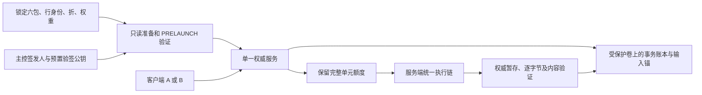
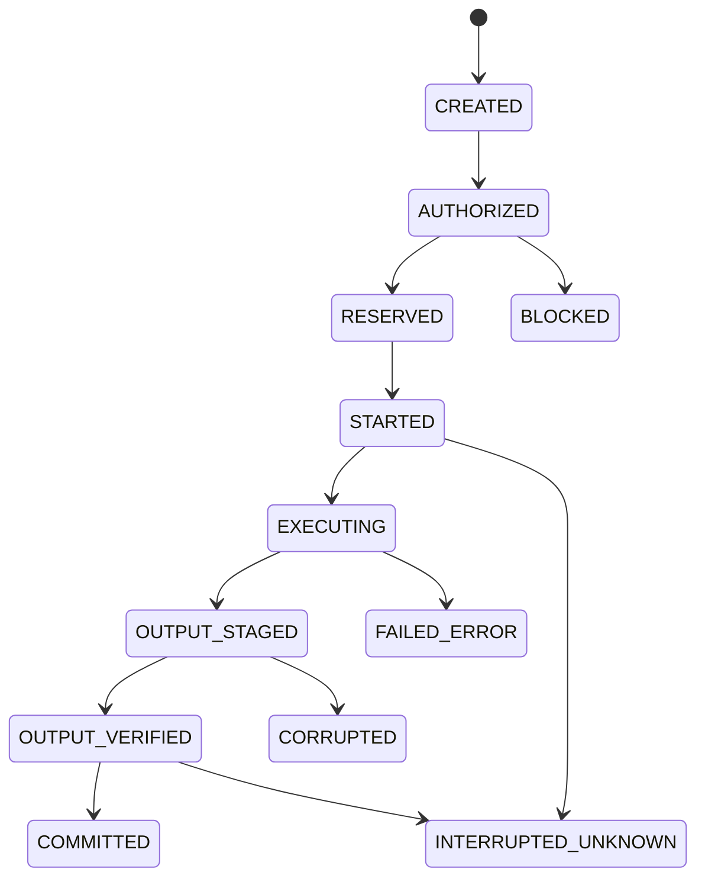

# ADR 001 · P5.15 R1 V8 恢复治理

状态：本轮 CODEX_MAC 实现，供 CHATGPT_MASTER 独立验收。原 A 身份 aa4de242906913e5a369b93bc304bdde64ded10de77f2d3fe67bdf20203f5fa2。Run B 隔离。AUTH-01、AUTH-02 当前均未批准。

## 决定与作用域

使用单实例权威服务和 SQLite 独占写入卷。工作端只连接由部署方固定的权威入口，无本地账本写路径。权威端在显式初始化阶段以核验的 Run A 封存、预置公钥和存储身份建立账本。运行命令只打开已存在的卷，初始化不暴露为 RPC。独立 UID、私有库目录和部署方保护的信任锚是信任边界。当前仅部署研究隔离域，正式训练调用有不可通过 CLI、配置、工厂注入解除的硬守卫。

## 权威身份与信任

- 客户端发来期望身份供拒错，服务只用受信部署锚中固定的 activity/Run A/authority、服务地址和已初始化的库身份。授权消费与事务关联以服务器的唯一约束和事务为准。快照是证据输入，复制到客户端、改工作根、改 run_id 不产生写权限。
- 服务端权威目录与客户端执行目录分离。客户端拿不到服务卷写权限或主控私钥。单实例由进程锁和数据库写事务限定；服务副本、卷恢复和管理员态目录复制必须单独治理。权威库使用独立同级持久围栏，固定设备与 inode，核对原状态指纹后才准入事务，推进围栏并 fsync 后才提交数据库。拦截旧 SQLite 字节原 inode 恢复。围栏提交与数据库之间异常形成不匹配时直接停机。正式部署必须防止数据库和围栏被同时回滚，迁移时须废止旧存储身份。未部署真实权威及其宕机恢复锚前保持 NO_GO。
- 授权按规范 JSON 字节做 Ed25519 验签，固定签发主体、签发者、公钥、用途域和授权编号。正式与合成信任域分离，测试私钥只由本地夹具即时生成。运行时不接受请求自带密钥。AUTH-01 与 AUTH-02 分离授权语义。验签后核生效/过期、原 A、权威身份、单位、额度、源码/依赖/六包/行与折、PRELAUNCH 全件及内含真实源码。预先落盘时间以服务端时钟核对，合成时间与正式事前托管证据分开。
- 正式模式与合成模式共享准备、授权和封存验证结构。可执行工作副作用由服务端唯一入口产生。CLI 及内部调用走相同验证器和事务，外来上下文字典、折、工厂及模拟选项没有进入真实模式的入口。

## 单元事务与故障模型

权威库包含初始化身份、原 A 基线、授权消费、每单元唯一预留及尝试、详尽事件、有序调用计数和完成 manifest。整体预留发生在任何 START 前。授权、预算预留与事务号一起原子提交。每类 START 在对应调用前持久。START 后的硬中断按 INTERRUPTED_UNKNOWN 保守恢复，保留使用或预留账，查询原事务且不自动重试。事务 COMMITTED 是唯一完成事实。远端调用结果不明时以权威状态查询为准，不在本地另开事务。

输出写私有暂存路径，文件和目录 fsync 后回读，完整校验大小、SHA 与内容。F1 核完整六元组、确切顺序和标签、各行状态、预测范围、重复和缺项、逐母损失及母等权指标，对真实输入强制 9,055 行和 1,912 母。FINAL_DEV 读取一致的 F1/F2/F3 提交身份且没有预测调用。模型与 scaler 归档核列、维数、数值、输入和代码身份。不可变 manifest 与完成事件在同一数据库事务提交，文件写入先行。写盘后数据库事务前崩溃只能形成不可消费的孤儿输出。已提交回读发现损坏时留痕并阻断下游。

## 原件迁移、部署与验收

原 A ZIP/PRELAUNCH 先核全件和内件 SHA、14 事件、7 令牌、F1 失败与 F2/F3 9,503＋5,250 行。模型/scaler 原字节只读验哈希。先演练隔离权威迁移，原卷、旧权重、旧结果和 V1–V7 不写。第 13 项活体锁缺直接见证时保留 UNKNOWN。

- 本地仅用 Unix socket 的隔离服务和临时数据。外部双容器试验须由隔离 Linux 宿主运行，受测 worker 实挂同一持久卷的 socket 暴露层，数据库目录仅权威容器可写。记录容器/主机/卷身份、服务身份、账本摘要、事务与授权事件、并发返回。MAC 只做过相同端点的多进程不能计为双容器。
- B01 验收三个模式、真实六包 check-only、无授权与测试域拒绝及整条合成正式链。B02 验收历史迁移、物理副本竞争、断线、未知状态、独立进程与双容器。B03 验收签名、信任域、主体、来源、矩阵、完整折和 PRELAUNCH。B04 验收第二行身份、输出缺失或损坏、崩溃提交边界、只读复用及 FINAL_DEV 预测 0。

冻结范围：仅本 worktree 的 research/p515_recovery_v8 及任务自有 ignored 实物目录。Writer 为 CODEX_MAC 工程实现，独立 Reviewer 只读。正式资产、现有产品与生产配置均列禁止路径。PASS_SIGNAL 为独立逐项验收，双容器 BLOCKED 时不得升格为工程准入。STOP_RULE 为任何真实模型入口或原账非零写入，以及真实主控权限/持久存储材料缺失的正式步骤。
