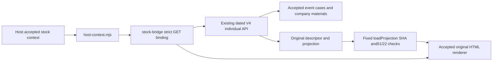

# Individual stock interface for the frozen framework

Compatible source target: `lexi2016/v4`, branch
`codex/dashboard-framework-collab-20261030`, commit
`0ae4a66d90c12a0d0335b5f7f65b528879c5e9cf`.
All46 files under `research/dashboard_framework_collab_20261030` remain protected.
This package supplies individual-stock read/render methods; it does not deploy
the sanitized framework or provide its day catalog, observation schedule,
credentials, storage authorization or global-date owner.

`stock-bridge.mjs` requires explicit `origin`, `basePath`, `fetcher` and the frozen
framework's `loadProjection`. It performs same-origin GETs for the existing dated
stock detail, original-chart descriptor/projection, company materials and event
cases. Source ISO date is strictly converted to compact API date; observation
date is separately supplied by the host and never inferred from the source day.
Date/symbol/generation/input/formula/manifest and immutable asset SHA must agree.
Missing/invalid/newer context clears old data, aborts previous requests and ignores
late callbacks. An optional `numeric_manifest` pins a precise statistics revision;
otherwise the first validated detail response binds that request's revision.
A revision change during the reads fails closed and waits for a new host context.

Context `group` and `horizon` are forwarded to the same group/horizon event-case GET. Explicit open options take precedence over context fields. Absent/all group uses the accepted row’s first eligible group; absent horizon uses d2. A named group outside that row fails closed. No original-group rate is substituted for a smallK or immature selected group.

The actual API projection descriptor has no byte-count/encoding fields. The
bridge bounds one GET, measures its actual raw length, detects gzip magic and
passes that same in-memory buffer to the frozen `loadProjection`; the framework
verifies SHA, decoded size, original51/22 structure and provenance without a
second HTTP projection download. It returns the framework's exact adapted
`{symbol,data:{rows},manifest:{formula_sha256},provenance}` shape.

`OriginalFullChart.bind/setStock/clear/setWindow` wraps the already accepted
same-origin original HTML renderer in an explicitly supplied container. It never
implements a replacement price/volume/formula renderer. Window changes call the
original `setOriginalWindow`; chosen dates can be forwarded through the host's
`original-chart-date` event. The adapted projection and renderer descriptor must
be bound to the current explicit context before rendering.

Host wiring (example only; no default endpoint or implicit bootstrap):

```js
import {loadProjection} from '../dashboard_framework_collab_20261030/src/projection-view.mjs';
import {makeStockBridge} from './stock-bridge.mjs';
import {installStockContext} from './host-context.mjs';

const bridge = makeStockBridge({
  origin: location.origin,
  basePath: authorizedStockApiBasePath,
  fetcher: fetch,
  loadProjection,
  container: originalStockChartHost,
  eventTarget: window,
});
window.OriginalFullChart = bridge.OriginalFullChart;
bridge.OriginalFullChart.bind();
const subscription = installStockContext({
  target: window,
  bridge,
  onReady: showBoundIndividualStock,
  onError: showExplicitMissingStock,
});
// The framework owner emits a complete context after accepting its day/stock:
// window.dispatchEvent(new CustomEvent('v4-stock-context', {detail: {
//   source_date, observation_date, symbol, generation, input_sha256,
//   group, horizon, // optional explicit selected group and d2/d5, forwarded unchanged
//   numeric_manifest, // optional exact statistics revision
// }}));
// subscription.dispose() removes only this listener and clears this stock view.
```

The frozen framework currently keeps day/stock state inside `workbench.mjs` and
emits no such complete context. Its portable adapter expects `/history` and
`/days/...` host routes; the individual API uses its existing stock endpoints.
Therefore the source seam is executable and tested, while unmodified framework
bootstrap is **not integrated**. The framework owner must supply that context
handoff (or call `bridge.open(context)` directly), an explicit container, API
configuration and completion-event routing. This package does not edit those46
files or invent missing host authorization.

Company materials preserve received values, nulls, report period/kind, units and
source refs exactly. The public framework's `company.mjs` validator deliberately
throws and its `explanationFacts` is empty; this package returns
`EXTERNAL_VALIDATOR_REQUIRED` and the real received materials for the authorized
host's own renderer/validator. It does not declare that disabled shell complete.
PENDING/NOT_MATERIALIZED/UNKNOWN and immature zero-valid samples remain explicit;
zero valid observations never becomes a0% success claim.

The following is the bounded interface callflow, not a full dynamic code graph:



Troubleshooting:

1. If nothing loads, confirm the host explicitly supplies its authorized same-origin API base/container and emits the complete context; the frozen shell does not emit it automatically.
2. For an identity error, compare source ISO date, symbol, generation, input and numeric manifest against the actual dated GET. Keep observation date independent; do not fall back to another day or revision.
3. For a projection error, inspect the immutable URL/SHA, actual bytes/encoding and the fixed framework validator result. Reuse the accepted projection; do not recalculate the formula or substitute a screenshot as verified interactive data.
4. If company content is absent, distinguish NOT_MATERIALIZED/PARTIAL_RECEIVED from the frozen shell's disabled validator. Preserve null, report period, units and source refs; request the owner's explicit validator seam.
5. For a stale view, check that newer context aborts the old request and that dispose/clear releases this adapter's listener/renderer. Website completion/SSE belongs to the separately accepted V4 path; this source package does not install framework polling or global-date behavior.

Run the focused tests in the complete upstream tree:

```sh
node --test research/stock_panel_collab_20261030/stock-bridge.test.mjs
```

For this isolated worktree, `FRAMEWORK_REFERENCE_ROOT` can point to the controller's
hash-verified13-file read-only snapshot of the same frozen commit. It is a test
input path, not a production endpoint.

Validation includes13 contract tests and one actual local GET sample001328:
861 original rows, actual265177-byte gzip projection, one projection HTTP GET,
frozen original formula SHA, exact company/event identity and unchanged source
values. Renderer API behavior uses a focused host double; the sanitized framework
has not been installed or visually accepted. The existing V4 individual website
has its own separate real completion/UI acceptance, documented in the main
individual handoff.

RESEARCH_ONLY=true; production_allowed=false; buy_gate_updated=false;
orders_sent=false. No backend writes, acquisition, source/price recomputation,
trade action, public-framework deployment or permission expansion.
